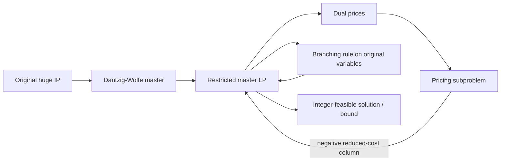

# Branch-and-Price: Column Generation for Solving Huge Integer Programs

> [!tldr] Branch-and-price solves huge integer programs by generating variables on demand and branching in a way that preserves pricing structure.

## Problem & Motivation

Large-scale integer programs in scheduling, assignment, and routing often have too many feasible columns to enumerate up front. The paper formalizes a practical way to combine decomposition and exact search so these models remain solvable.

## Bibliographic Record

- Publication: *Operations Research*, Vol. 46, No. 3, pp. 316–334, June 1998
- Authors: Cynthia Barnhart; Ellis L. Johnson; George L. Nemhauser; Martin W. P. Savelsbergh; Pamela H. Vance
- DOI: 10.1287/opre.46.3.316
- Companion metadata note: [[_papers/barnhart1998branchandprice/barnhart1998branchandprice.md]]

## Method / Architecture

Branch-and-price combines:
1. A **restricted master problem** with only a subset of columns,
2. A **pricing subproblem** that finds improving columns,
3. A **branch-and-bound tree** that enforces integrality while keeping pricing tractable.

## Key Equations

$$
\min \sum_{j \in \Omega} c_j \lambda_j
$$

$$
\sum_{j \in \Omega} a_{ij}\lambda_j = 1 \quad \forall i, \qquad \lambda_j \in \{0,1\}
$$

Pricing uses reduced cost from master duals; add column $j$ when:

$$
\bar c_j = c_j - \sum_i \pi_i a_{ij} < 0
$$

## Results

| Setting | Result |
|---|---|
| Generalized assignment and crew scheduling style models | Column generation avoids full-variable enumeration and scales to much larger formulations |
| LP bound quality | Stronger relaxations than many compact formulations |
| Search behavior | Effective only with branching choices that preserve pricing structure |

## Limitations

- Performance depends heavily on subproblem structure and separation/branching engineering.
- Branching directly on generated-column variables can break decomposition and is usually avoided.
- Degeneracy and tailing-off in column generation remain practical pain points. ^[inferred]

## Related

- [[concepts/branch-and-price-column-generation]]
- [[references/boland2017-continuous-time-service-network-design]]
- [[references/archetti2023-branch-and-cut-sop]]
- [[concepts/exact-multitrip-vrptw-framework]]
- [[concepts/adaptive-large-neighborhood-search-for-mip]]

## Sources

- [[_papers/barnhart1998branchandprice/barnhart1998branchandprice-extracted.md]]
- [[_papers/barnhart1998branchandprice/barnhart1998branchandprice.md]]
