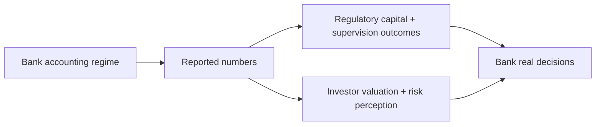

# Financial Accounting in the Banking Industry — Empirical Literature Review

> [!tldr] Organizes banking-accounting research into three evidence streams and shows where regulation, disclosure, and incentives interact with bank behavior.

## Problem & Motivation

Bank accounting sits at the intersection of valuation, regulation, and financial stability. The review synthesizes what empirical work has established and where causal identification remains weak.

## Method / Architecture

The paper synthesizes prior empirical studies in three streams:
1. **Valuation/risk relevance** of accounting numbers for banks,
2. **Managerial discretion** in earnings and regulatory-capital reporting,
3. **Real effects** of accounting rules on lending, risk-taking, and balance-sheet choices.

## Key Equations

No single structural model is introduced; the contribution is integrative. A useful decomposition is:

$$
\text{Observed bank behavior} = f(\text{economic fundamentals},\; \text{accounting regime},\; \text{regulatory incentives})
$$

This decomposition is a synthesis device rather than a tested equation in the source. ^[inferred]

## Evidence & Numbers

- **U.S. banking crises and accounting implications (Fig. 1):** 1930–1933 Great Depression — market-value accounting for investment portfolios was eliminated to favor long-term value investing; 1982–1984 Latin American Debt Crisis — U.S. banks were slow to record loan loss provisions on LDC debt and kept accruing interest; 1988–1991 Savings and Loan Crisis — market-value accounting was reintroduced to eliminate gains trading; 2007–2009 Financial Crisis — market-value accounting was accused of magnifying liquidity spirals and fire sales, and the incurred-loss model was argued to delay loss recognition and reduce lending.
- **Capital tiers (FDICIA, footnote 21):** five tiers from "well capitalized" to "critically undercapitalized"; well capitalized needs a leverage ratio ≥5%, Tier 1 ratio ≥6% and total capital ratio ≥10%. Citigroup disclosed a 7.5% Tier 1 target, above the 6% requirement.
- **Bank equity history (Berger et al. 1995, as cited in §2.1.3):** bank equity as a share of assets fell from more than 40% before the National Banking Act of 1863 to about 15% when the Federal Reserve and the FDIC were created in 1914 and 1933, reaching current levels by the mid-1940s — evidence the paper uses against the implicit-guarantee explanation for bank leverage.
- **Provision-model landscape (§5.2, Table 1):** nine discretionary-provision models with no consensus specification; a factor analysis of their residuals yields three factors with eigenvalues greater than one and four model variants, and residuals from those four models are used as discretionary-provision proxies to predict restatements and receipt of SEC comment letters.
- **Research clustering (§4):** most provision studies concentrate in the early-to-mid 1990s, and fair-value studies cluster around adoptions of FAS 107, 115 and 119; the literature largely ignores creditor and depositor information problems.
- **Post-crisis regime (§7):** BASEL III, the Dodd-Frank Act, elimination of the Qualified Special Purpose Entity concept, and FASB/IASB exposure drafts on financial-instrument measurement and impairment.

## Results

| Stream | Main finding |
|---|---|
| Valuation and risk relevance | Accounting signals remain decision-relevant, but interpretation shifts with crisis conditions and measurement regime |
| Discretionary reporting | Evidence supports meaningful discretion in loan-loss provisioning [[references/ozili2017-bank-loan-loss-provisions-review]] and capital reporting |
| Real effects | Loan loss provisioning timeliness affects the pro-cyclicality of lending; delayed provisioning amplifies the lending cut in crises because replenishing equity is harder then |
| Methodological takeaway | Before/after studies of new regulation cannot cleanly attribute changes because control groups are hard to identify, and predicting a proposed rule assumes banks will not adapt to it — the paper names this as the central methodological challenge |

## Limitations

- As a review, conclusions inherit identification limits from underlying studies.
- Some policy debates (e.g., fair value during crises) remain contested in direction and magnitude. ^[ambiguous]
- Cross-jurisdiction comparability is uneven because banking regimes differ materially. ^[inferred]
- The paper's own factor analysis shows that the loan-loss-provision models used in the literature rest on incompatible assumptions about what is exogenous, and the authors are not aware of any study testing the validity of these models, so discretion estimates are not comparable across studies.
- Fair value is claimed to be pro-cyclical through the regulatory-capital channel, but Plantin et al. (2008) suggest other channels, and the paper reports weak, mixed evidence supporting no definitive conclusion.
- Studies of proposed regulation rely on the unlikely assumption that banks will not change behavior to circumvent new requirements, so predictions about future regimes stay untested. ^[inferred]

## Related

- [[references/ball2016-accruals-cash-flows-operating-profitability]]
- [[concepts/cash-based-operating-profitability]]
- [[concepts/ordering-information-portfolio-selection]]
- [[references/almgren2004-optimal-portfolios-ordering-information]]
- [[concepts/negative-book-equity-style-classification]]
- [[references/pincus2007-accrual-anomaly-international-evidence]] — pincus2007 shows earnings management via income-increasing accruals drives the anomaly in common-law markets, the stock-side counterpart of bank provisioning discretion catalogued here.
- [[references/ozili2017-bank-loan-loss-provisions-review]] — ozili2017 reviews post-2000 loan loss provisioning research: provisioning discretion links to income smoothing, capital management, signalling and Basel procyclicality, extending the bank provisioning discretion catalogued here.

## Sources

- [[_papers/beatty2014financial/beatty2014financial-extracted.md]]
- [[_papers/beatty2014financial/beatty2014financial.md]]
