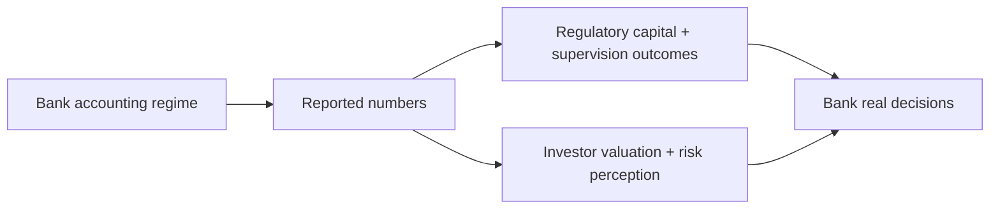

# Financial Accounting in the Banking Industry — Empirical Literature Review

> [!tldr] Organizes banking-accounting research into three evidence streams and shows where regulation, disclosure, and incentives interact with bank behavior.

## Problem & Motivation

Bank accounting sits at the intersection of valuation, regulation, and financial stability. The review synthesizes what empirical work has established and where causal identification remains weak.

## Method / Architecture

The paper synthesizes prior empirical studies in three streams:
1. **Valuation/risk relevance** of accounting numbers for banks,
2. **Managerial discretion** in earnings and regulatory-capital reporting,
3. **Real effects** of accounting rules on lending, risk-taking, and balance-sheet choices.

## Key Equations

No single structural model is introduced; the contribution is integrative. A useful decomposition is:

$$
\text{Observed bank behavior} = f(\text{economic fundamentals},\; \text{accounting regime},\; \text{regulatory incentives})
$$

This decomposition is a synthesis device rather than a tested equation in the source. ^[inferred]

## Results

| Stream | Main finding |
|---|---|
| Valuation and risk relevance | Accounting signals remain decision-relevant, but interpretation shifts with crisis conditions and measurement regime |
| Discretionary reporting | Evidence supports meaningful discretion in loan-loss provisioning and capital reporting |
| Real effects | Accounting and prudential design can alter lending and risk behavior, not only disclosure outcomes |
| Methodological takeaway | Regulatory before/after studies often face weak controls and adaptation effects. ^[ambiguous] |

## Limitations

- As a review, conclusions inherit identification limits from underlying studies.
- Some policy debates (e.g., fair value during crises) remain contested in direction and magnitude. ^[ambiguous]
- Cross-jurisdiction comparability is uneven because banking regimes differ materially. ^[inferred]

## Related

- [[references/ball2016-accruals-cash-flows-operating-profitability]]
- [[concepts/cash-based-operating-profitability]]
- [[concepts/ordering-information-portfolio-selection]]
- [[references/almgren2004-optimal-portfolios-ordering-information]]

## Sources

- [[_papers/beatty2014financial/beatty2014financial-extracted.md]]
- [[_papers/beatty2014financial/beatty2014financial.md]]
