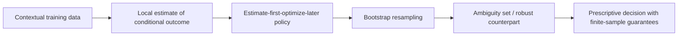

# Bootstrap Robust Prescriptive Analytics

> [!tldr] Robustifies contextual prescriptions against data scarcity and overfitting by optimizing against bootstrap-derived ambiguity sets.

## Problem & Motivation

Estimate-first-optimize-later pipelines are vulnerable to estimation error when data are sparse or noisy. The paper asks how to keep these pipelines practical while adding out-of-sample reliability guarantees.

## Method / Architecture

Start with local contextual estimators, then solve a robustified prescription that controls bootstrap disappointment probability.

## Key Equations

Contextual objective:

$$
z^*(x_0) \in \arg\min_{z\in\mathcal{Z}} \mathbb{E}[L(z,Y)\mid X=x_0]
$$

Generic estimate-first-optimize-later form:

$$
\hat z_n(x_0) \in \arg\min_{z\in\mathcal{Z}} \hat\rho_n(z;x_0)
$$

Bootstrap robust guarantee (disappointment control):

$$
D_{\operatorname{tr}[n]}^{\infty}\!\left[\mathbb{E}_{D_{\operatorname{bs}[n]}}^{n}\left[L\big(z_{\operatorname{tr}[n]}(x_0),Y\big)\mid X=x_0\right] > c_n\right] \le b
$$

## Results

| Setting | Result |
|---|---|
| Local-learning prescriptions | Robustification reduces overfitting risk relative to plain estimate-first-optimize-later pipelines |
| Finite-sample behavior | Bootstrap construction gives explicit disappointment-probability control |
| Tractability | Robust Nadaraya-Watson and nearest-neighbor variants can be solved as tractable convex programs under stated assumptions |

## Limitations

- Robustness introduces additional modeling choices (ambiguity-set calibration, confidence levels).
- Conservatism can reduce nominal performance when data are already rich. ^[inferred]
- Practical performance is sensitive to bootstrap design and computational budget. ^[inferred]

## Related

- [[concepts/predictive-to-prescriptive-analytics]]
- [[references/bertsimas2020-predictive-to-prescriptive-analytics]]
- [[concepts/ordering-information-portfolio-selection]]
- [[concepts/adaptive-large-neighborhood-search-for-mip]]

## Sources

- [[_papers/bertsimas2022bootstrap/bertsimas2022bootstrap-extracted.md]]
- [[_papers/bertsimas2022bootstrap/bertsimas2022bootstrap.md]]
