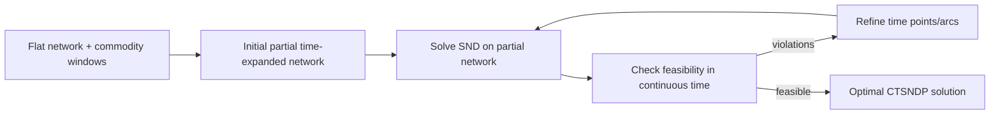

# The Continuous-Time Service Network Design Problem

> [!tldr] Solves continuous-time service network design via iterative refinement on small partial time-expanded networks, avoiding full discretization blow-up.

## Problem & Motivation

Service network design in less-than-truckload and parcel consolidation depends on both routing and dispatch timing. Standard coarse discretization can miss consolidation opportunities, while fine discretization explodes model size. The paper asks whether one can still obtain a true continuous-time optimum without explicitly modeling every time point.

## Method / Architecture

The algorithm repeatedly solves a relaxation on a partially time-expanded network and refines only the time points and timed arcs needed to eliminate infeasibilities.

## Key Equations

Objective on the time-expanded network:

$$
z(\mathcal{D}_{\mathcal{T}})=\min \sum_{((i,t),(j,\bar t))\in\mathcal{A}_{\mathcal{T}}} f_{ij}y_{ij}^{t\bar t} + \sum_{k\in\mathcal{K}}\sum_{((i,t),(j,\bar t))\in\mathcal{A}_{\mathcal{T}}} c_{ij}q_k x_{ij}^{kt\bar t}
$$

Capacity coupling:

$$
\sum_{k\in\mathcal{K}} q_k x_{ij}^{kt\bar t} \le u_{ij} y_{ij}^{t\bar t}
$$

Sufficient time-point structure (Theorem 1 intuition):

$$
t \in \{e_k\}\ \cup\ \left\{e_k + \sum_{a\in P} tt_a\right\}
$$

## Results

| Setting | Result |
|---|---|
| Instances with 30 nodes, 700 arcs, 400 commodities | Often solved to proven optimality in < 30 minutes |
| Full 1-minute expansion equivalent size | >1.5M variables and ~1.4M constraints |
| Test-suite coverage | 97% of several hundred instances solved |
| Runtime quality | Average solve time < 15 minutes; unsolved cases averaged ≤2.5% gap after 2 hours |

## Limitations

- Empirical evidence is concentrated on benchmark families with specific network and horizon structures.
- Performance depends on refinement policy and MIP solver behavior; tuning may matter across domains. ^[inferred]

## Related

- [[concepts/dynamic-discretization-discovery]]
- [[references/boland2017-dynamic-discretization-tsptw]]
- [[concepts/branch-and-price-column-generation]]
- [[references/barnhart1998-branch-and-price-column-generation]]

## Bibliographic Record

- Citation key: boland2017continuoustime
- DOI: `10.1287/opre.2017.1624`
- Canonical URL: <https://pubsonline.informs.org/doi/10.1287/opre.2017.1624>
- Publication: *Operations Research*, 2017
- Authors: Natashia Boland; Mike Hewitt; Luke Marshall; Martin Savelsbergh
- Companion metadata note: [[_papers/boland2017continuoustime/boland2017continuoustime.md]]

## Sources

- [[_papers/boland2017continuoustime/boland2017continuoustime-extracted.md]]
- [[_papers/boland2017continuoustime/boland2017continuoustime.md]]
