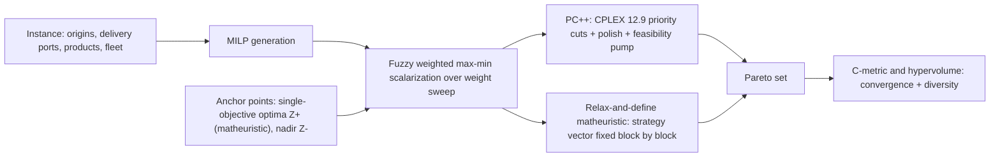

# Multi-Objective Maritime Cargo Routing and Scheduling (dos Santos & Borenstein, 2024)

> [!tldr] A multi-commodity, heterogeneous-fleet maritime cargo routing MILP with three competing objectives (makespan, freight cost, delivery delays), solved by fuzzy weighted max–min scalarization, where each scalarized instance is attacked by two purpose-built heuristics because the generated MILPs are too large to solve directly.

## Problem & Contribution

The problem (MO-m-CRSPTW-DL-SL) moves bulk products from origin ports to delivery ports using a heterogeneous fleet of bulk carriers (handymax / handysize, 35–60k DWT). Each product travels in a dedicated vessel compartment, loads are splittable, and transshipment is not allowed. A vessel route is a sequence of pickup ports followed by a sequence of delivery ports (P,P,...,P,D,D,...,D), with dummy start/finish depot nodes s and f, port berth limits, port draft limits, a minimum total load per vessel, a minimum quantity per product, and a fixed 15-knot cruise speed.

Three objectives are optimized simultaneously:

$$
\min Z_1 = \alpha \quad \text{with } \alpha \ge t^{A}_{ifv} \; \text{(makespan)}
$$

$$
\min Z_2 = \sum_v C^V_v\sum_j t^{A}_{jfv} + \sum_{i,j,v} P^C_j\,x_{ijv} + \sum_{i,j,p,v} H^C\,t^{E}_{ijpv} + \sum_v W^C_v\sum_j E^T_j\,x_{ijv}
$$

$$
\min Z_3 = \sum_{i,j}\sum_{p \in P'}\sum_{j \in N'} t^{L}_{ijpv} \quad \text{(delays of selected products at selected ports)}
$$

$Z_2$ aggregates chartering cost proportional to arrival time, port facility fees, time-window penalties, and demurrage from late port departures; $Z_3$ isolates the delays the charterer actually cares about. Decision variables are per-compartment product quantity on each arc, arrival/departure/lateness/delay times, arc-usage binaries, visit binaries, and berth-occupancy binaries.

![[_papers/dossantos2024multiobjective/images/page_5_image_2.jpg]]
*Figure 1 (paper): two vessel routes in a three-origin / four-destination network — every pickup precedes every delivery, and loads split across compartments.*

## Method / Architecture

Scalarization is fuzzy weighted max–min over membership functions. For a minimization objective $Z_l$:

$$
\mu_{Z_l}(x) = \frac{Z_l^{+} - Z_l(x)}{Z_l^{+} - Z_l^{-}}, \qquad
\max_x \; \lambda \;\; \text{s.t. } \theta_k\lambda \le \mu_{Z_k}(x),\;\; \sum_k \theta_k = 1,\;\; \theta_k \ge 0
$$

$Z_l^{+}$ comes from a single-objective optimum (the matheuristic of dos Santos et al. 2020) and $Z_l^{-}$ from the nadir point, so the membership normalization is anchored by real runs rather than by assumptions. A weight sweep ($\theta \in \{0, 0.05, \dots, 1\}$, 21 combinations) at three CPU budgets (300 / 900 / 1800 s per combination) generates the Pareto set.

Two heuristics are required because the generated MILPs blow up (big-M = 1000, dense time-window structure):

- **PC++** — CPLEX 12.9 priority cut search, Rothberg's *PolishAfterIntSol* polish, then Fischetti & Lodi repair / local branching (feasibility pump), with time split $t_1 = 2t_2$.
- **Relax-and-define matheuristic** — a strategy vector $SB = [x_{ijv}, y_{ijpv}, y^D_{ijpv}]$ fixed integer-block by integer-block with the remainder relaxed ($t_s = \text{CPU}/6$), followed by an improvement phase identical to the last two steps of PC++.

Real-world business rules added for the case study: at most 6 origin and 13 delivery ports, one berth per chartered vessel, minimum 20 kt per vessel and 4 kt per product, at most 2 pickups and 3 deliveries per vessel, no two vessels in the same port simultaneously (a binary $a_{vw}$ replaces the vessel-visit indicator), and a north↔south direction-change fee added to the second objective, giving $Z_2' = Z_2 + \beta_{ij}^V\gamma_v^C M_v^V$.

## Results

16 real fertilizer-company instances (2–4–7 up to 5–7–5 origins / destinations / products), three instance sizes, 15 product types.

| Metric | PC++ | Matheuristic | Reading |
|---|---|---|---|
| Avg $C(PC++,\text{Mat})$ | 0.3571 | — | Convergence toward the PC++ front |
| Avg $C(\text{Mat},PC++)$ | — | 0.3273 | Convergence toward the matheuristic front |
| Avg hypervolume | **2.9917** | 2.8173 | PC++ ≥ matheuristic on 10 of 16 instances, especially with >5 origin/destination ports |

Case study (8 products, 5 delivery ports) — Pareto points compared to the company's Excel plan:

| Run | weights $(\theta_{Z1},\theta_{Z2},\theta_{Z3})$ | $Z_1$ (days) | $Z_2'$ | $Z_3$ | vs company plan |
|---|---|---|---|---|---|
| 6 | 0.5, 0, 0.5 | 87 | 2,769,750 | 1 | −34% cost, −17% makespan, −90% delay |
| 8 | 0.75, 0, 0.25 | 75 | 2,336,380 | 5 | — |
| 17 | 0.6, 0.1, 0.3 | 78 | 2,719,640 | 4 | −40% cost, −13% makespan, −70% delay |

![[_papers/dossantos2024multiobjective/images/page_17_chart_2.jpg]]
*Figure 2 (paper, instance 7): projection of the Pareto front produced by the weight sweep on one origin–destination–product size.*

Cost is dominated by route direction changes: the company's own plan changed direction on 75% of routes. Discounting the direction-change fee by 10/15/20% cuts cost by 2.73/6.59/9.01% (Run 6), 3.54/5.80/6.84% (Run 8), and 8.38/12.51/13.58% (Run 17); at a 20% discount Run 6 reaches zero delay — the fee is the binding lever that trades cost against lateness.

## Limitations

- Travel times, port times, and demand are deterministic; uncertainty (weather, congestion, demand shifts) is explicitly out of scope.
- The true Pareto front is unknown, so comparisons are convergence/diversity metrics (Zitzler et al. 2000), not dominance against ground truth. ^[ambiguous]
- No CO$_2$ / emissions objective; the authors name evolutionary multi-objective optimization and emissions as next steps. ^[inferred]
- The weight sweep is discrete and coarse (21 combos), so the front is sampled, not enumerated. ^[inferred]
- Results come from one fertilizer company; the business rules (direction-change fee, berth exclusivity) are case-specific.
- Business rules were added by the authors to fit the company, and they change the objective, so cross-instance comparisons use the original three-objective model. ^[inferred]

## Related

- [[concepts/multi-objective-maritime-cargo-routing-scheduling]]
- [[concepts/maritime-inventory-routing-problem]]
- [[references/fagerholt2023-maritime-inventory-routing-survey]]
- [[concepts/maritime-routing-under-uncertainty]]
- [[references/mutlu2016-lng-annual-delivery-program]]

## Bibliographic Record

- Citation key: dossantos2024multiobjective
- DOI: 10.1111/itor.13147
- Canonical URL: <https://onlinelibrary.wiley.com/doi/abs/10.1111/itor.13147>
- Publication: *International Transactions in Operational Research* (2024)
- Authors: Pietro Tiaraju Giavarina dos Santos; Denis Borenstein
- Companion metadata note: [[_papers/dossantos2024multiobjective/dossantos2024multiobjective.md]]

## Sources

- [[_papers/dossantos2024multiobjective/dossantos2024multiobjective-extracted.md]]
- [[_papers/dossantos2024multiobjective/dossantos2024multiobjective.md]]
- [[_papers/dossantos2024multiobjective/images/page_5_image_2.jpg]]
- [[_papers/dossantos2024multiobjective/images/page_17_chart_2.jpg]]
