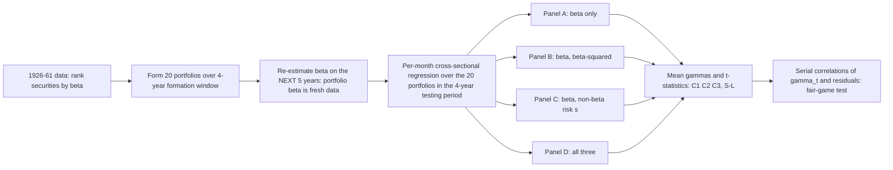

# Risk, Return, and Equilibrium: Empirical Tests (Fama & MacBeth, 1973)

> [!tldr] Fama and MacBeth test the two-parameter (mean–variance) model on 42 years of NYSE data using a two-stage design: form 20 portfolios on estimated β, then regress monthly portfolio returns on β, β², and non-β risk. The results — β positively priced, γ₂ and γ₃ insignificant, γ₂/γ₃ behaving like fair games — are the standard evidence that systematic (β) risk is the priced risk in equilibrium.

## Problem & Contribution

The two-parameter model (Tobin 1958, Markowitz 1959, Fama 1965) says the expected return of a security in portfolio p is fixed by the first two moments of its return distribution:

$$
E(R_i) - E(R_m) = S_m\left[\sum_j x_{jm}\frac{\sigma_{ij}}{\sigma(R_m)} - \sigma(R_m)\right]
$$

which, defining $\beta_i = \sigma_{ij}/\sigma(R_m)$, becomes:

$$
E(R_i) = \big[E(R_m) - S_m\sigma(R_m)\big] + S_m\sigma(R_m)\beta_i
$$

Black (1972) supplied the key structural point: with homogeneous expectations and unrestricted short selling, **the market portfolio built on value weights is always efficient**, so it is a valid reference portfolio for testing — this is what makes "the market" usable in an empirical test, not just in theory.

The stochastic generalization tested:

$$
R_{it} = \tilde\gamma_0 + \tilde\gamma_1\beta_i + \tilde\gamma_2\beta_i^2 + \tilde\gamma_3 s_i + \tilde\eta_{it}
$$

with hypotheses: **C1** linearity in β ($E(\tilde\gamma_2)=0$), **C2** no systematic non-β risk ($E(\tilde\gamma_3)=0$), **C3** positive risk–return tradeoff ($E(\tilde\gamma_1)=E(R_m)-E(R_0)>0$), the **S-L hypothesis** $E(\tilde\gamma_0)=R_f$ (Sharpe/Lintner riskless borrowing and lending), and **market efficiency** — $\tilde\gamma_2, \tilde\gamma_3, \tilde\gamma_1 - [E(R_m)-E(R_0)], \tilde\gamma_0 - E(R_0)$, and $\tilde\eta$ are all fair games (weak form: no exploitable serial correlation).

## Method / Architecture

The design is a **errors-in-variables** solution: the portfolio β used in the testing period is estimated on data *not* used for formation, so the "regression phenomenon" (bunching of extreme-β portfolios) does not contaminate the tests. Nine rolling windows are used (formation 1926-29 … 1955-61 → estimation 1930-34 … 1962-66 → testing 1935-38 … 1967-68), with 710 → 1,261 securities available and 435 → 845 meeting data requirements.

Non-β risk is measured as the standard deviation of market-model residuals:

$$
R_{it} = a_i + \beta_i R_{mt} + \epsilon_{it}, \qquad \sigma^2(R_i) = \beta_i^2\sigma^2(R_m) + \sigma^2(\epsilon_i) + 2\beta_i\,\text{cov}(R_m,\epsilon_i)
$$

Per-month cross-sectional regression (20 portfolios, β recomputed monthly):

$$
R_{pt} = \hat\gamma_0 + \hat\gamma_1\hat\beta_{p,t-1} + \hat\gamma_2\hat\beta_{p,t-1}^2 + \hat\gamma_3\bar s_{p,t-1} + \hat\eta_{pt}
$$

The market proxy is **Fisher's Arithmetic Index** — the equally weighted average of all NYSE-listed stock returns.

## Results

| Panel | Model | $\bar\gamma_0$ | $\bar\gamma_1$ | $\bar\gamma_2$ | $\bar\gamma_3$ | $t(\bar\gamma_0 - R_f)$ |
|---|---|---|---|---|---|---|
| A | $\gamma_0+\gamma_1\beta$ | .0061 | .0085 | — | — | **2.55** |
| B | $+\gamma_2\beta^2$ | .0049 | .0105 | **−.0008 (t = −.29)** | — | 1.42 |
| C | $+\gamma_3 s$ | .0054 | .0072 | — | **.0198 (t = .46)** | 1.59 |
| D | all three | .0020 | .0114 | −.0026 (t = −.86) | .0516 (t = 1.11) | .20 |

- **C1, C2, C3 not rejected** over the overall period: linearity in β holds, non-β risk is not systematically priced, the β premium is positive. ^[extracted]
- **Fair games**: serial correlations of $\hat\gamma_1, \hat\gamma_2, \hat\gamma_3, \hat\eta$ are close to zero relative to $\sigma(\rho)\approx1/\sqrt{n}$ (.05 overall, .09 in 10-year, .13 in 5-year windows) → consistent with market efficiency in the weak form.
- **S-L rejected**: $\bar\gamma_0$ exceeds $R_f$ by more than 0.4% per month in most periods; γ₀ is the return on the minimum-variance zero-β portfolio, so the finding is essentially the same as Black, Jensen & Scholes (1972).
- **Subperiod nonlinearity**: $t(\bar\gamma_2)$ = −2.83 (1946-55, Panel B), −2.72 (1951-55, Panel B), −2.16/−2.54 (Panels D); significant curvature in the two long subperiods, not a single window.
- **Variance decomposition** ($F = s^2(\hat\gamma_j)/s^2(\phi_j)$): F ≈ 0.8–2.8 for γ₂ and 1.1–3.4 for γ₃ — there is *real* month-to-month variation in γ₂ and γ₃ (so their means are zero but they are not identically zero), and adding β² and $s$ inflates the noise in $\hat\gamma_0$ and $\hat\gamma_1$ (Panel A F reaches 11.75 for γ₀ and 28.0 for γ₁).
- **Behaviour of the market**: dividing $\overline{R_m-R_f}$ and $\hat\gamma_1$ by $\sigma(R_m)$ yields estimated risk premia that are more constant through time, especially across the three long subperiods (1946-55, 1951-55, 1956-60), because the post-war drop in $\hat\gamma_1$ is matched by a downward shift in $s(R_m)$.
- **Appendix A1 — event studies**: substituting $\hat\gamma_1 = R_m - \hat\gamma_0$ gives a two-factor model $R_{it} = \hat\gamma_0(1-\hat\beta_i) + \hat\beta_i R_{mt} + \hat\eta_{it}$; the one-factor market model's residuals contain the market factors γ₀, γ₂, γ₃, so the two-factor form cleans event studies (accounting-standard changes, insider trading, mergers), with residual-variance reduction proportional to $(1-\hat\beta)^2$.

## Limitations

- **Thick-tailed returns** (characteristic exponent ≈ 1.8, per Fama 1965, Blume 1970, Officer 1971) mean normal-based significance levels are overestimates; the non-rejection results are conservative, and tests are biased toward rejection.
- **Multifactor evidence is in the paper**: residual interdependence is largest at the β extremes, i.e. non-β risk is correlated across securities — a hint of multiple factors, which the single-index framework cannot resolve. ^[inferred]
- S-L tests are sensitive to the β estimate used; the paper itself calls its S-L conclusions ambiguous.
- Equally weighted market proxy (Fisher index) deviates from the value-weighted "market portfolio" theory demands. ^[inferred]
- Pre-1970 data and survivor-selected NYSE firms; the paper's tests cannot separate delisting bias. ^[inferred]
- The paper tests the two-parameter model, not modern cross-sectional asset-pricing factors; later work (Fama-French) reframes the question. ^[inferred]

## Related

- [[concepts/fama-macbeth-two-stage-cross-sectional-regression]]
- [[concepts/ordering-information-portfolio-selection]]
- [[references/black1992-global-portfolio-optimization]]
- [[references/chen2010-shrinkage-mmse-covariance-estimation]]
- [[references/almgren2004-optimal-portfolios-ordering-information]]
- [[concepts/statistical-investigation-lifecycle]]

## Bibliographic Record

- Citation key: fama1973risk
- DOI: 10.1086/260061
- Canonical URL: <https://www.journals.uchicago.edu/doi/abs/10.1086/260061>
- Publication: *Journal of Political Economy*, 1973-05
- Authors: Eugene F. Fama; Michael C. MacBeth
- Companion metadata note: [[_papers/fama1973risk/fama1973risk.md]]

## Sources

- [[_papers/fama1973risk/fama1973risk-extracted.md]]
- [[_papers/fama1973risk/fama1973risk.md]]
