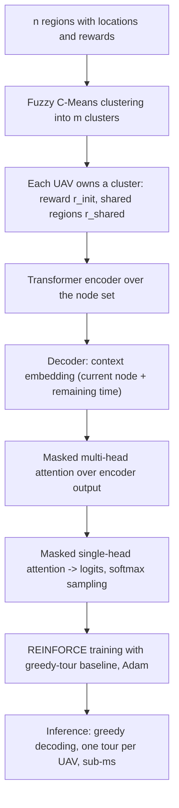

# Solving Routing Problems for Multiple Cooperative UAVs Using Transformer Networks (Fuertes et al., 2023)

> [!tldr] Multi-UAV mission planning split into clustering (fuzzy C-means, one cluster per UAV) and routing (a Kool-style Transformer trained with REINFORCE). On a new Orienteering Problem with Multiple Prizes and Types of Nodes, the Transformer is the best accuracy-per-time method: ~0.1 optimality gap versus Compass at 100× lower inference time, and cooperation is what makes adding UAVs pay off.

## Problem & Contribution

**OP-MP-TN** — nodes $\{0, \dots, n+1\}$ (start and finish depots), $m$ agents, $m$ clusters from a FCM partition. Reward rules:

- $r^a = r_{init}$ for a region in agent $a$'s own cluster
- $r^a = r_{shared}$ for a region in another agent's cluster, with $r_{init} > r_{shared}$ (cooperative: 1 vs 0.5; non-cooperative: 1 vs 0)

$$
\max \sum_{a=1}^{m}\sum_{i=0}^{n+1}\sum_{j=0}^{n+1} r_i^a x_{ij}^a
$$

s.t. one departure from 0 and one arrival at $n+1$ per agent; in/out degree in $[0,1]$ (a node may be visited by several different agents, at most once per agent, and paths must be continuous); per-agent time $\sum t_{ij}^a x_{ij}^a \le t_{max}$; fleet time $\max_a t_{0,n+1}^a \le t_{max}$ (all UAVs share speed); Miller-Tucker subtour elimination:

$$
u_i^a - u_j^a + n\,x_{ij}^a \le n - 1
$$

Assumptions: Euclidean distances, no obstacles, zero service time, coordinates in $[0,1]$.

The paper's point is architectural: **deep learning is used for multi-agent routing with shared reward, not just single-vehicle TSP**, and the solver runs in milliseconds, which is what real multi-UAV mission planning needs.

![[_papers/fuertes2023solving/images/page_1_image_2.jpg]]
*Fig. 1a (paper): scenario — regions of different colours, UAVs assigned by clustering, shared regions reward both agents.*

## Method / Architecture

Encoder: input linear embedding (no positional encoding, unlike NLP Transformers), then $N=3$ attention stacks of multi-head attention + linear embedding, each wrapped by a skip connection and batch normalization:

$$
\text{Attention}(Q,K,V) = \text{SoftMax}\left(\frac{QK^T}{\sqrt{h/M}}\right)V
$$

Decoder: context embedding (current node + remaining time as Query) → masked multi-head attention (encoder output as Key/Value, mask marks visited/infeasible nodes) → masked single-head attention producing logits

$$
\text{logits} = f_{mask}\left(C\cdot\tanh\left(\frac{Q'K'^T}{\sqrt{h}}\right)\right)
$$

with $C=10$ clipping, $h=128$, $M=8$ heads; sampling during training, greedy at inference. **One shared network serves all agents** — no per-agent model.

Training with REINFORCE (Williams 1992), cost $L(\nu) = -\sum r x$, objective $L(\theta|\alpha) = E_{p_\theta(\nu|\alpha)}[L(\nu)]$, gradient with a **greedy-tour baseline** $b(\alpha)=\arg\max p_\theta(\nu|\alpha)$ to reduce variance. Adam, lr 1e-4, batch 512 (256 at $n=200$). Evaluation metrics: reward gap vs the best method and $\log_{10}$ time gap vs the fastest method.

![[_papers/fuertes2023solving/images/page_4_image_3.jpg]]
*Fig. 3 (paper): Transformer structure — encoder attention stacks with skip + batch norm, decoder context embedding, masked attention, masked single-head attention, softmax sampling.*

## Results

Datasets: $n \in \{20,50,100,200\}$, $m \in \{2,4\}$, $t_{max} = 2,3,4,5$ respectively (each agent can reach roughly half the nodes); 10,000 test/validation instances, >1,000,000 training samples; 95% CI, Alexander-Govern test $p\approx0$.

Per-agent reward and inference time:

| Method | R(20) | R(50) | R(100) | R(200) | t(20) ms | t(50) | t(100) | t(200) |
|---|---|---|---|---|---|---|---|---|
| **Transformer** | 6.862 | 18.809 | 37.385 | 66.523 | **0.054** | **0.128** | **0.188** | **0.476** |
| Compass (MIP) | 7.070 | 19.844 | 40.083 | 74.907 | 3.364 | 11.046 | 32.897 | 108.794 |
| Tsiligirides (heuristic) | 5.782 | 15.310 | 30.516 | 56.058 | 0.149 | 0.171 | 0.201 | 0.258 |
| Pointer Network | 6.234 | 17.374 | 34.254 | 62.234 | 0.082 | 0.345 | 0.819 | 2.605 |
| Graph Pointer Network | 6.224 | 17.228 | 34.325 | 62.681 | 0.126 | 0.335 | 1.096 | 3.624 |
| OR-Tools + Guided Local Search | 5.587 | 13.091 | 22.055 | 33.073 | 50.1 | 53.8 | 53.8 | 53.8 |

- The Transformer is the **best accuracy/time trade-off**: reward gap vs Compass ≈0.1 that scales reasonably, at 100× lower inference time than the MIP.
- **Cooperation scales with fleet size** (n=100): 2 UAVs cooperative 92.932 reward / 99.034 nodes vs 89.703 / 91.028 non-cooperative; 4 UAVs cooperative **149.538 / 204.566** vs 99.897 / 108.561.
- Two UAVs alone already cover almost all nodes, so non-cooperative 4-UAV fleets gain almost nothing from the extra agents — cooperation is what converts fleet size into reward. ^[inferred]
- Cooperation also mitigates lost UAVs (battery depletion, communication loss), because shared regions stay reachable.
- Clustering comparison FCM vs K-Means vs size-constrained K-Means: no clear winner; FCM chosen for low computational cost. ^[extracted]

![[_papers/fuertes2023solving/images/page_8_chart_2.jpg]]
*Fig. 5a (paper): optimality gap versus Compass by node count — the Transformer tracks the MIP within about 0.1.*

## Limitations

- Euclidean distances, no obstacles, zero service time, no region size — the model is a stylized OP, not an operational UAV mission plan.
- No global/whole-system architecture: clustering and routing are separate stages, so clustering quality limits routing quality. ^[inferred]
- No optimality certificate: comparison is against Compass as best-known method, and Compass itself is not proven optimal.
- One shared network for all agents; no per-agent specialization, no learned communication.
- Clustering choice is empirical, not justified by theory; the authors say no method dominates.
- Single-node-count training regimes; behavior beyond $n=200$ and on real air-space constraints is untested. ^[inferred]

## Related

- [[concepts/transformer-seq2seq-routing-solver]]
- [[concepts/cooperative-multi-agent-uav-routing]]
- [[concepts/set-orienteering-problem]]
- [[concepts/k-multi-visit-drone-routing-problem]]
- [[references/poikonen2020-k-mvdrp]]
- [[references/lu2024-hybrid-evolutionary-algorithm-sop]]

## Bibliographic Record

- Citation key: fuertes2023solving
- DOI: 10.1016/j.engappai.2023.106085
- Canonical URL: <https://www.sciencedirect.com/science/article/pii/S0952197623002695>
- Publication: *Engineering Applications of Artificial Intelligence*, 2023-06-01
- Authors: Jorge Fuertes; Victor del-Blanco; Jose M. Jaureguizar; Luis Navarro; Miguel A. García
- Companion metadata note: [[_papers/fuertes2023solving/fuertes2023solving.md]]
- Source code: <http://gti.ssr.upm.es/data>

## Sources

- [[_papers/fuertes2023solving/fuertes2023solving-extracted.md]]
- [[_papers/fuertes2023solving/fuertes2023solving.md]]
- [[_papers/fuertes2023solving/images/page_1_image_2.jpg]]
- [[_papers/fuertes2023solving/images/page_4_image_3.jpg]]
- [[_papers/fuertes2023solving/images/page_8_chart_2.jpg]]
