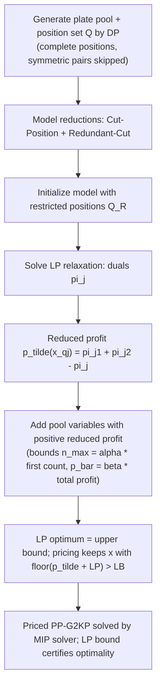

# Modeling Two-Dimensional Guillotine Cutting Problems via Integer Programming (Furini, Malaguti & Thomopulos, 2016)

> [!tldr] The first MIP over **all** feasible guillotine cuts on a 2D panel, using plates and cut positions. A plate-and-position variable pool is generated by DP, reduced by two model reductions, then priced via LP duals; 16 of 21 large instances now solve to optimality, and the model is up to two orders of magnitude faster than the only prior guillotine MIP.

## Problem & Contribution

Guillotine cuts are parallel to panel sides, run edge-to-edge across the plate being cut, and are applied in stages of parallel cuts. Variants studied: **2KP** (one panel $L\times W$, items with $l_i, w_i, p_i, u_i$ copies, maximize profit of a packable subset), **2CSP** (identical panels, item $i$ must be obtained $d_i$ times, minimize panels; $d_i = 1$ is 2BPP), **SPP** (strip of fixed length, minimize used width), plus their guillotine versions **G2KP, G2CSP, GSPP**; all NP-hard.

The extension is Biss's (2009) 1D cut-and-residual-element model lifted to 2D:

- **Plate set $J$**: plate 0 is the panel; plate $j$ has dimensions in $\{1..W\}\times\{1..L\}$; $\bar J\subseteq J$ is the set of plates whose dimensions equal an item (these also denote items), with plate $0\in\bar J$.
- **Cut positions** $Q(j,h)\subseteq\{1..w_j-1\}$, $Q(j,v)\subseteq\{1..l_j-1\}$.
- **Variables** $x^o_{qj}$ = number of times plate $j$ is cut at position $q$ with orientation $o$; $a^o_{qkj}=1$ when cutting plate $j$ at position $q$ with orientation $o$ produces plate $k$; $y_j$ = number of plates of type $j$ kept as final items.

**PP-G2KP** (Plate-and-Position model):

$$
\max \sum_{j\in\bar J} p_j y_j
$$
$$
\sum_{k\in J}\sum_{o\in O}\sum_{q\in Q(k,o)} a^o_{qkj}x^o_{qk} - \sum_{o}\sum_{q\in Q(j,o)} x^o_{qj} - y_j \ge 0 \quad j\in\bar J,\ j\ne 0
$$
$$
\sum_{k\in J}\sum_{o\in O}\sum_{q\in Q(k,o)} a^o_{qkj}x^o_{qk} - \sum_{o}\sum_{q\in Q(j,o)} x^o_{qj} \ge 0 \quad j\in J\setminus\bar J
$$
$$
\sum_{o}\sum_{q\in Q(0,o)} x^o_{q0} + y_0 \le 1, \qquad y_j \le u_j, \qquad x,y\ \text{integer}\ge 0
$$

Model size is pseudo-polynomial: worst case $W\cdot L$ plates, $O(W)$ horizontal + $O(L)$ vertical positions per plate, so $O(WL(W+L))$ $x$-variables + $n$ $y$-variables. Largest instance gcut12: 66,415,467 variables, ~489,428 plates, ~0.5M constraints.

![[_papers/furini2016modeling/images/page_1_image_0.jpg]]
*Fig. 1 (paper): (a) non-guillotine pattern, (b) three-stage-restricted guillotine pattern, (c) unrestricted guillotine pattern — the model covers all cuts in (c), not just stage- or strip-width-restricted ones.*

## Method / Architecture

- **Complete position set** $Q$ via a dynamic program extending the Martello/Vigo-style DP, handling multiple copies: $q\in Q(j,h)$ iff $q$ is a sum of widths $w_i$ (with multiplicities $\le u_i$) of items fitting plate $j$; symmetric positions ($q$ and $w_j - q$ both present) are removed automatically by the DP.
- **Restricted position set** $Q_R(j,h)=\{q:\exists i\in I_j, q=w_i\}$, $Q_R(j,v)=\{q:\exists i\in I_j, q=l_i\}$ — cuts at positions equal to item sizes.
- **Theorem 1**: if a plate can fit **at most five items** by guillotine cuts, an optimal solution exists using only restricted positions. The bound is tight — Example 1 (items $l=[47,40,40,40,11,4]$, $w=[34,30,30,8,31,60]$, panel 102×51) shows six obtainable items where no restricted-position solution gets all six; the worst-case loss ratio is $z_R/z_U\le 5/6$.
- **Cut-Position reduction** (uses the five-item property: cumulated area of the six smallest items exceeds plate area), **Redundant-Cut reduction** (removes trim cuts, i.e. cuts producing one useful plate, in two structural cases).
- **Variable pricing** via LP duals: reduced profit $\tilde p(x^o_{qj}) = \pi_{j_1} + \pi_{j_2} - \pi_j$, computable in linear time over the pool; tuning $\alpha=0.20$, $\beta=0.25$.
- Feasible solutions from an iterated greedy heuristic (random item order, take first $k$ items whose cumulated profit improves the incumbent, pack with First Fit Decreasing, 1M iterations after last incumbent update); Restricted PP-G2KP's optimal value is a valid LB.
- Extensions: PP-G2CSP ($\min$ panels with $y_j\ge d_j$), multi-panel costs $c_t$, PP-GSPP (strip width variable $z$, first cut horizontal with $Q(0,h)=\{1..W\}$, no vertical strip cuts).
- Implementation: CPLEX 12.5, Core2 Quad 2.50 GHz single core, 8 GB RAM, 1-hour limits. Instances = 21 OR-library (gcut, cgcut, wang20, okp) + 38 Lodi/Mondinelli/Trick instances, weighted and unweighted.

![[_papers/furini2016modeling/images/page_3_image_5.jpg]]
*Fig. 2 (paper): a cut at position q on plate j with orientation o produces plates j1 and j2 — the plate-and-position variable structure.*

## Results

| Regime | Complete PP-G2KP direct CPLEX | Restricted PP-G2KP | Priced PP-G2KP (full procedure) |
|---|---|---|---|
| small (<100k vars, 21 inst.) | 19 solved to optimum | ≤25% vars, ≤65% plates for 80% of instances | all solved except Hchl8s (gap 1.8% → 0.8%) |
| medium (100k–500k vars, 18 inst.) | 12 solved to optimum | best computed solution for all but three | 3 more solved to optimum, gaps shrink, times cut by 1–2 orders |
| large (>500k vars, 21 inst.) | **0 solved** (A5 and all large at 100% gap, no feasible solution) | — | **16 solved to optimum**; gap ≤9% for three of the remaining five |

- Of 51 instances solved to optimality, the Restricted model's solution is optimal in 48 — pricing mostly **certifies** optimality rather than improving the incumbent. ^[inferred]
- Greedy heuristic: max gap ≤17%, runtime seconds.
- Reductions: variables halve for several gcut instances, 72–96% residual variables for the rest; **Priced model <40% of variables for ~80% of instances**; plates unchanged for 90% of instances, ≤10% residual plates for 3%.
- Known optima the model fails to match: gcut11 = 955,389, okp2 = 22,502, okp3 = 24,019.
- Against the only prior guillotine MIP (Bebel et al., GSPP, 5 items, $L=300$, $\alpha/\beta$ families, wide/almost-square/long item shapes): average times FMT vs BCE — 37.0 vs 5174, 13.9 vs 6218, 74.0 vs 5511, 10.4 vs 3299, 50.1 vs 688, 22.5 vs 5993, 58.8 vs 80, 18.6 vs 5169 → **two orders of magnitude faster on 6 of 8 classes**.
- APT-style instances (many tiny items in large panels) are intractable for PP-G2KP because the variable count explodes. ^[extracted]
- The Restricted model allows cuts at item-size positions **and** further cuts on the resulting plates (items of lengths 2,3,5 → cut at 5, then at 2 on the resulting plate), which the extension of the three-stage model without stage limits does not allow. ^[extracted]

![[_papers/furini2016modeling/images/page_13_chart_3.jpg]]
*Fig. 5 (paper): performance profile of Restricted vs Complete model — residual variables and plates by instance.*

![[_papers/furini2016modeling/images/page_19_chart_0.jpg]]
*Fig. 9 (paper): performance profile of Complete vs Priced PP-G2KP — pricing moves the resolution frontier.*

## Limitations

- Pseudo-polynomial size: $O(WL(W+L))$ variables makes large panels with fine-grained dimensions unusable (the APT instances).
- Restricted positions lose quality in general — the paper's own Example 1 gives a $5/6$ worst-case bound; restricting cuts to item sizes is not always optimal.
- No published comparison to the state-of-the-art guillotine algorithm (Algorithm A1 of Delorme et al.) in time, because A1 needs upper bounds from non-guillotine 2KP and unconstrained 2D, and solves all OR-library instances within 46 s after a 60 s LB phase. ^[ambiguous]
- LP-relaxation time limit is hit for Hchl6s and Hchl7s, so no valid upper bound for those.
- No CO₂/environmental objective, no stochastic dimensions, no multi-panel cost optimization beyond the model form.
- Results are single-core CPLEX 12.5 (2016-era solver); modern solvers and parallelism would change the absolute times. ^[inferred]

## Related

- [[concepts/plate-cut-position-guillotine-mip]]
- [[concepts/four-stage-guillotine-cut-bounded-knapsack]]
- [[references/clautiaux2018-hypergraph-guillotine-knapsack]]
- [[references/barnhart1998-branch-and-price-column-generation]]
- [[concepts/branch-and-price-column-generation]]

## Bibliographic Record

- Citation key: furini2016modeling
- DOI: 10.1287/ijoc.2016.0710
- Canonical URL: <https://pubsonline.informs.org/doi/abs/10.1287/ijoc.2016.0710>
- Publication: *INFORMS Journal on Computing*, 2016-11
- Authors: Fabio Furini; Elisa Malaguti; Dimitri Thomopulos
- Companion metadata note: [[_papers/furini2016modeling/furini2016modeling.md]]

## Sources

- [[_papers/furini2016modeling/furini2016modeling-extracted.md]]
- [[_papers/furini2016modeling/furini2016modeling.md]]
- [[_papers/furini2016modeling/images/page_1_image_0.jpg]]
- [[_papers/furini2016modeling/images/page_3_image_5.jpg]]
- [[_papers/furini2016modeling/images/page_13_chart_3.jpg]]
- [[_papers/furini2016modeling/images/page_19_chart_0.jpg]]
