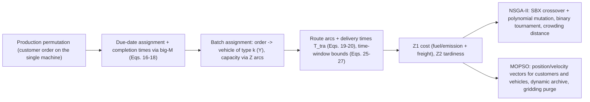

# Multi-Objective Sustainable Supply Chain Scheduling (Ganjia, Rabet, Sajadi & Daneshvar Kakhki, 2026)

> [!tldr] Ganjia et al. integrate single-machine production scheduling, due-date assignment, batch delivery and heterogeneous-fleet vehicle routing with customer time windows in one bi-objective MINLP: freight + fuel/emission cost vs total delivery tardiness. Instances were designed from operational data of a local catering company. NSGA-II tuned by a Taguchi L27 design reaches 69.3 MLCU and 858 h within 50 iterations (45% and 96% reductions), beating MOPSO on convergence, spacing, diversity and a weighted metric, while the ε-constraint check confirms relative gaps below 0.8%.

## Problem & Contribution

![[_papers/ganjia2026multiobjective/images/page_10_image_3.jpg]]
*Fig. 1 (paper): An overview of the problem.*

- Integrated sustainable supply chain scheduling (ISSCS): decide production sequence and completion times, due dates, which vehicle of which type carries which order, and the route arcs, so batches reach customers inside their time windows.
- Objective 1 is cost: fixed route cost $FC$ plus first-/last-mile and tour costs, plus a **fuel/emission term** linear in vehicle weight + load and quadratic in average speed, multiplied by distance.
- Objective 2 is customer service: total tardiness $\sum_j T_{del_j}$ with $T_{del_j}\ge T_{tra_j}-DD_j$ and $T_{del_j}\ge 0$.
- Time windows are modeled per customer with $\sum_w H_{w,j}=1$ and $L_{w,j}\le T_{tra_j}\le U_{w,j}$; big-M ($M=10{,}000$) links completion times to tour start.
- The paper's contribution is the **integration** (production + due date + batch delivery + routing in one model), the two tuned metaheuristics, and an explicit multi-metric validation of the Pareto fronts.

## Method / Architecture

Chromosome = **two permutations**: customer production sequence and vehicle delivery sequence (paper Fig. 2 example: C9 C4 C10 C2 C1 C3 C5 C7 C6 C8 over K3 K1 K5 K4 K2 with fleet types F1/F2). MOPSO carries position and velocity vectors for both blocks, with inertia $\omega^t=\omega^{max}-(\omega^{max}-\omega^{min})t/it_{max}$, contraction factor $\alpha$, clamped $v_{min}\le v\le v_{max}$, dynamic external archive, and fitness $fit(i,k)=H(i,k)/density(i,k)$ with purging from the most crowded grid cell.

Cost objective (paper Eq. 1, per route, paraphrased):

$$Z_1=\sum_{i\in V}FC+\sum_{i\in V}\sum_{j\in C}\Big[(C_{em}+C_{fu})\big(\alpha_{i,j}(Wei_v+WL_{i,j})+\beta_v V^2_{av_{i,j}}\big)Dis_{i,j}\Big]$$ ^[inferred]

Service objective (paper Eq. 2) and tardiness link (paper Eq. 21):

$$Z_2=\sum_{j\in C}T_{del_j},\qquad T_{del_j}\ge T_{tra_j}-DD_j,\quad T_{del_j}\ge 0$$

Taguchi L27 tuning with S/N $=-\log\big(\sum_i y_i^2/n\big)$ (Eq. 42), run on the algorithm parameters of Table 5 with the composite WM as the response; tuned settings: NSGA-II $N_{pop}=50$, crossover rate 0.5, mutation rate 0.4, 150 iterations; MOPSO $N_{pop}=50$, $\omega=0.6$, $C_1=0.5$, $C_2=1.25$, $\alpha=0.3$, 120 iterations. ε-constraint validation (Mavrotas & Florios) with relative gap $=(y^{alg}_i-y^\varepsilon_i)/y^\varepsilon_i$ (Eq. 44).

## Results

| Comparison (paper) | NSGA-II | MOPSO |
|---|---|---|
| Cost after 50 iterations | 126.1965 → **69.30** MLCU (45%) | 108.39 → 68.09 MLCU (32%) |
| Tardiness after 50 iterations | 23,950 → **858** h (96%) | 29,595 → 1,047 h (96%) |
| Pareto front size (Table 11, large-size problems) | 12 points, 69.3–84.97 MLCU, 858–9,830 h | 9 points, 68.09–86.72, 1,047–10,682 h |
| ε-constraint avg gap (cost / time) | 0.002% / 0.008% | 0.020% / 0.055% |
| Metric averages: RNI / GD / MID / SP / MD / ACT | 0.004 / 72 / 42 / 217 / 13 / 48 s | 0.002 / 94 / 142 / 555 / 3 / 60 s |

![[_papers/ganjia2026multiobjective/images/page_24_chart_5.jpg]]
*Fig. 5 (paper): The first Pareto fronts of the algorithms.*

The single-objective tension is explicit (paper Tables 9–10, ten-customer example): economic orientation gives cost 74.52 with time 9.43 h, customer orientation gives time 2.17 h with cost 245.11, and the ε-constraint compromise gives 112.98 / 5.29 h. ε-constraint solves the eight small experiments up to 8 vehicles × 20 customers in 10–38 min and **fails** on the 23- and 25-customer instances within the time limit, while NSGA-II runs them in 0.35–0.45 min — the exact method is the validator, the metaheuristics are the scalable solvers. Per-experiment cost gaps (Tables 7–8): NSGA-II 0.000–0.008%, MOPSO 0.008–0.034%.

The paper's own weighted metric $WM=(RNI+2GD+2MID+2SP+2MD+2ACT)/11$ averages 0.57 for NSGA-II vs 0.61 for MOPSO, and the source reports NSGA-II ahead on all six indicators — including higher RNI and lower ACT, where the direction convention is asserted, not defined. Table 14's per-problem WM favors MOPSO on 4 of 8 problems, and its third column lists problem indices under a "Weighted metric" heading, an extraction artifact. ^[ambiguous]

## Limitations

- Deterministic parameters, one production machine, no mid-horizon rescheduling; service measured only by tardiness — the authors themselves flag delivery reliability and time-window adherence as missing service metrics.
- Cost is dominated by the fuel/emission coefficient structure ($\alpha$ linear in weight+load, $\beta_v$ quadratic in speed); calibration of $\alpha=[0.09,0.15]$, $\beta=[2.67,4.14]$, $C_{em}=7.3$, $C_{fu}=0.64$ comes from a single local case, so cost comparisons across fleets are not portable.
- Only NSGA-II and MOPSO are benchmarked; the authors point to self-adaptive and hybrid metaheuristics, island models, polyploid evolutionary algorithms, memetic search, surrogate-assisted evolution and hyper-heuristics, plus stochastic, robust and fuzzy optimization for the fixed parameters, as next steps.
- Parameter tuning is Taguchi S/N on the composite WM response, so the tuned settings optimize overall front quality, not each objective separately. ^[inferred]
- Exact validation scales only to ~20 customers, so large-instance front quality is unverified against ground truth.

## Related

- [[concepts/multi-objective-metaheuristic-tuning-validation]]
- [[references/yi2023-ace-gsf-automated-design-cvrptw]] — q-learning-guided memetic search in ACE's RL-design frame.
- [[concepts/green-vehicle-routing-problem-taxonomy]]
- [[concepts/vehicle-routing-with-synchronization-constraints]]
- [[concepts/periodic-scheduling-under-capacity-constraints]]
- [[concepts/hyper-heuristics]]
- [[references/asghari2021-green-vrp-state-of-the-art-review]]
- [[references/gendreau2019-handbook-metaheuristics]]

## Bibliographic Record

- Citation key: `ganjia2026multiobjective`
- DOI: `10.1007/s12351-025-01013-0`
- Canonical URL: <https://doi.org/10.1007/s12351-025-01013-0>
- Publication: *Operational Research* (2026-01-13)
- Authors: Maliheh Ganjia; Rahmat Rabet; Seyed Mojtaba Sajadi; Mohammad Daneshvar Kakhki
- Companion metadata note: [[_papers/ganjia2026multiobjective/ganjia2026multiobjective.md]]

## Sources

- [[_papers/ganjia2026multiobjective/ganjia2026multiobjective-extracted.md]]
- [[_papers/ganjia2026multiobjective/ganjia2026multiobjective.md]]
- [[_papers/ganjia2026multiobjective/images/page_10_image_3.jpg]]
- [[_papers/ganjia2026multiobjective/images/page_24_chart_5.jpg]]
