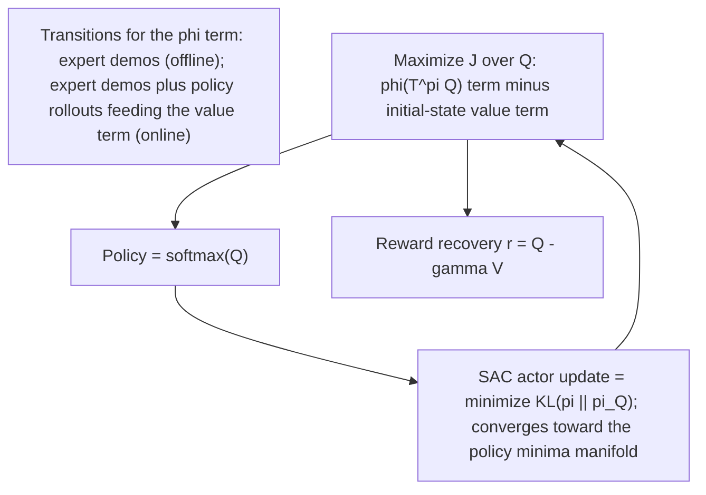

# IQ-Learn: Inverse soft-Q Learning for Imitation (Garg, Chakraborty, Cundy, Song, Geist & Ermon, 2022)

> [!tldr] IQ-Learn replaces the reward/policy min-max of adversarial imitation learning (GAIL, AIRL, ValueDICE) with a **single soft-Q function** that implicitly represents both. The learned Q is optimized directly, the policy is its softmax, and the reward is recovered as $r=Q-\gamma V^\pi$. It reaches expert-level MuJoCo returns from **one** expert demo, converges >3× faster than prior methods, correlates 0.99 with true rewards, and generalizes to unseen goals without being designed as a meta-learner.

## Problem & Contribution

- Adversarial IL methods inherit GAN-style instability, high-variance/biased gradients, hyperparameter sensitivity, and low sample efficiency; behavioral cloning is stable but ignores environment dynamics.
- The paper's question: can we learn a dynamics-aware soft-Q function **directly**, without adversarial training, so that both the optimal policy and the reward come from one learned object?
- Answer: yes. Any valid occupancy measure yields a ψ-regularized optimal policy under $L(\pi,r)=\mathbb E_{\rho_E}r-\mathbb E_{\rho_\pi}r-H(\pi)-\psi(r)$; the change of variables $r=\mathcal T^\pi Q$ (inverse soft Bellman, bijective by Lemma 3.2) makes the objective concave in Q (Prop 3.6) with a unique saddle point, so gradient-based maximization over Q is well posed.
- The offline χ² instantiation is *identical* to CQL's Q1-learning objective with zero rewards — IQ-Learn exposes the connection between offline RL regularization and imitation.
- Extras: a state-only reward variant (Eq. 14, "ILO") that imitates from observations without expert actions, and a monotonic-improvement guarantee (Theorem C.8) for the idealized objective.

## Method / Architecture

![[_papers/garg2022iqlearn/images/page_4_chart_9.jpg]]
![[_papers/garg2022iqlearn/images/page_4_chart_10.jpg]]
*Fig. 1 (paper): "Properties of IRL objective in reward-policy space and Q-policy space."*

Soft optimality and the IQ objective (paper Eqs. 1–2, 9):

$$\pi_Q(a|s)=\frac{1}{Z_s}\exp Q(s,a),\qquad Z_s=\sum_a\exp Q(s,a)$$

$$\mathcal J(\pi,Q)=\mathbb E_{\rho_E}\Big[\phi\big(Q(s,a)-\gamma\mathbb E_{s'\sim P}V^\pi(s')\big)\Big]-(1-\gamma)\,\mathbb E_{p_0}\big[V^\pi(s_0)\big]$$

Reward recovery (paper Eq. 11) and the offline χ² form (paper Eq. 12, identical to CQL Q1-learning with 0 rewards):

$$r(s,a,s')=Q(s,a)-\gamma\,\mathbb E_{s'}V^\pi(s'),\qquad \min_Q\ -\mathbb E_{\rho_E}[Q-V^*]+\frac{1}{4\alpha}\mathbb E_{\rho_E}\big[(Q-\gamma\mathbb E_{s'}V^*)^2\big]$$

Implementation is <15 lines on top of DQN (discrete) or SAC (continuous); divergence choice = the φ/ψ pair (KL, Jensen-Shannon, Hellinger, χ², Wasserstein-1 with gradient penalty, total variation with a tanh Q-bound; the exact bound expression $\frac{1}{1-\gamma}(\frac12+\log|A|)$ is not stated verbatim in the extracted source ^[ambiguous]). Divergence ablation on LunarLander (1 demo, 10 seeds): JS, Hellinger and χ² perform similarly; KL is worse. A "KL-fix" f-divergence form (one line, written in the source as `f(t)=t log t − t + 1` in prose, not as a formula ^[ambiguous]) unbiases ValueDICE's Donsker–Varadhan representation.

![[_papers/garg2022iqlearn/images/page_8_chart_5.jpg]]
![[_papers/garg2022iqlearn/images/page_8_chart_6.jpg]]
![[_papers/garg2022iqlearn/images/page_8_chart_7.jpg]]
*Fig. 2 (paper): "Offline IL results. We plot the average environment returns vs the number of expert trajectories."*

![[_papers/garg2022iqlearn/images/page_13_image_1.jpg]]
*Fig. 4 (paper): "Reward Visualization. We use a discrete GridWorld environment with 5 possible actions: up, down, left, right, stay. Agent starts in a random state. (With 30 expert demos)"*

![[_papers/garg2022iqlearn/images/page_27_image_0.jpg]]
*Fig. 14 (paper): "A variant of the Loop MDP from [34]. Taking actions labelled in green gives 1 reward, while actions in black give reward 0. The MDP is stochastic for action a1 in state s0, which with probability p leads to state s2, and with probability 1-p leads to state s1." BC visits only the expert's visited states (54 ± 5); dynamics-aware methods master the loop (100 ± 0, averaged over 5 seeds).*

## Results

| MuJoCo (1 expert demo) | GAIL | DAC | ValueDICE | IQ | Expert |
|---|---|---|---|---|---|
| Hopper | 3252.5 | 3305.1 | 3312.1 | **3546.4** | 3532.7 |
| Half-Cheetah | 3080.0 | 4080.6 | 3835.6 | **5076.6** | 5098.3 |
| Walker | 4013.7 | 4107.9 | 3842.6 | **5134.0** | 5274.5 |
| Ant | 2299.1 | 1437.5 | 1806.3 | **4362.9** | 4700.0 |
| Humanoid | 232.6 | 380.5 | 644.5 | **5227.1** | 5312.8 |

With 10 demos IQ is state-of-the-art in all five tasks (Humanoid 5288 vs 372 for GAIL). Atari with 20 demos: expert-level on Space Invaders (807 vs 823), Qbert 12,940 vs 11,496, near expert on Pong (19 vs 21) and Seaquest, below expert on Breakout (320 vs 376) and BeamRider (3,025 vs 4,295); GAIL/ValueDICE stay near random even at 1M steps, and IQ converges in ~300k steps, >3× faster than Q-learning RL.

| Evidence | Number |
|---|---|
| Reward Pearson correlation (CartPole / LunarLander / Hopper / Half-Cheetah / Pong) | 0.99 / 0.92 / 0.99 / 0.86 / 0.67 |
| GAIL / SQIL reward correlation on the same comparison | 0.90 / 0.72 |
| Loop MDP episode reward (BC vs SQIL vs IQ online χ²) | 54 ± 5 / 100 ± 0 / 100 ± 0 |
| Tabular IRL speed vs max-entropy IRL | >3× faster, similar rewards |
| Overfitting on Half-Cheetah | ValueDICE degrades after ~100k updates; IQ stays stable at expert reward |
| Reacher_easy, online (1 / 5 / 10 / 20 / 50 demos; expert ≈ 990) | 271.3 / 485.1 / 545.0 / 734.9 / 926.1 |
| Reacher_easy, offline (1 / 5 / 10 / 20 demos) | 105.4 / 120.1 / 210.6 / 325.0 |
| BC / GAIL on reacher_easy with 50 experts | 325.2 / 440.1 (= IQ with 5 demos) |

Dynamics ablation: setting $\gamma=0$ (removing dynamics-awareness from the objective) destabilizes training on CartPole with a strong decay of returns, while $\gamma=0.99$ converges.

Distribution shift: offline IQ **cannot** recover from an initial-state shift (the lander flies off frame); online IQ explores and lands with average reward 250 from 10 demos, first moving horizontally to the launch zone. Regularizing the reward on **both** expert and policy states is what enables this generalization. ^[inferred]

## Limitations

- Recovered rewards depend on environment dynamics, so rewards do not transfer trivially between tasks.
- Deployment needs safety and uncertainty handling; errors in expert data propagate through the learned Q.
- Offline IQ fails under initial-state distribution shift, and reward quality degrades in visually complex Atari games (Pong 0.67). ^[inferred]
- Offline ILO with 1 demo is below expert level; 10 demos recover expert level only on simple environments.
- Hyperparameters matter (discrete: batch 32, Q learning rate 1e-4, entropy coefficient 1e-2, 1e-3 optimal in some environments; continuous SAC: batch 256, critic/policy learning rates 3e-4, 3e-5 for complex tasks, soft target updates τ = 0.05); target networks gave no visible improvement in discrete training and slowed it down.
- Preprint status (arXiv); the reported "3×" comparisons span settings whose baseline code differs per method. ^[ambiguous]

## Related

- [[concepts/inverse-soft-q-imitation-learning]]
- [[concepts/transformer-seq2seq-routing-solver]]
- [[references/bertsimas2020-predictive-to-prescriptive-analytics]]
- [[references/cheng2020-drone-routing-energy-function]]
- [[concepts/statistical-investigation-lifecycle]]

## Bibliographic Record

- Citation key: `garg2022iqlearn`
- DOI: `10.48550/arXiv.2106.12142`
- Canonical URL: <http://arxiv.org/abs/2106.12142>
- Publication: *arXiv* (2022-11-03)
- Authors: Divyansh Garg; Shuvam Chakraborty; Chris Cundy; Jiaming Song; Matthieu Geist; Stefano Ermon
- Companion metadata note: [[_papers/garg2022iqlearn/garg2022iqlearn.md]]

## Sources

- [[_papers/garg2022iqlearn/garg2022iqlearn-extracted.md]]
- [[_papers/garg2022iqlearn/garg2022iqlearn.md]]
- [[_papers/garg2022iqlearn/images/page_4_chart_9.jpg]]
- [[_papers/garg2022iqlearn/images/page_4_chart_10.jpg]]
- [[_papers/garg2022iqlearn/images/page_8_chart_5.jpg]]
- [[_papers/garg2022iqlearn/images/page_8_chart_6.jpg]]
- [[_papers/garg2022iqlearn/images/page_8_chart_7.jpg]]
- [[_papers/garg2022iqlearn/images/page_13_image_1.jpg]]
- [[_papers/garg2022iqlearn/images/page_27_image_0.jpg]]
