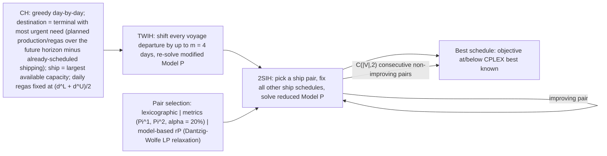

# Large Neighborhood Search for LNG Inventory Routing (Goel, Furman, Song & El-Bakry, 2012)

> [!tldr] Goel et al. cast LNG ship scheduling for a supply-chain **design analysis** as an arc-flow MIP over a daily time-space network, then solve it with a greedy construction heuristic (CH) and two improvement heuristics: shift every departure by ≤ 4 days and re-solve (TWIH), and fix all ships except a chosen pair and re-solve the reduced model (2SIH). CPLEX 11.1 proves optimality on only 3 of 14 instances and finds no good solution on the 4 hardest within 10 h; the heuristic reaches the best known solution on P14/P11 and better than best known on P13, at 15.7× geometric-mean CPU speedup.

## Problem & Contribution

- Setting for LNG supply-chain design: production terminals $L$, regasification terminals $R$, heterogeneous fleet $V$ (capacity $\gamma^V_v$), one-year horizon discretized **by day**; every visit carries a full load and discharges a full cargo (no split delivery); boil-off ≈ load capacity − discharge capacity; berth limits $b_j$ per terminal-day; seasonal production and travel; regas rate in a band $d^L_r \le d_{r,t} \le d^U_r$; annual demand $D_r$ must be met.
- Objective penalizes lost production $o_{l,t}$, regas stockouts $s_{r,t}$ (spot purchases), and unmet annual demand $\delta^D_r$, with **monotonically decreasing** time weights $w_{l,t} > w_{l,t+1}$ so losses are reported at the time they occur rather than being pushed to the end of the horizon.
- Contributions: an arc-flow formulation built on Song & Furman (2010) and the integer multi-commodity net-flow view of Savelsbergh & Song (2008) (one ship = one commodity); the CH + TWIH + 2SIH pipeline; three pair-selection policies for 2SIH (lexicographic, metrics-based, model-based LP); and 14 realistic instances of up to 232,856 binary variables — far larger than published MIRP instances.

## Method / Architecture

![[_papers/goel2012large/images/page_6_image_2.jpg]]
*Fig. 1 Example of time-space network structure*

Node $(j,t)$ = terminal $j$ on day $t$. Per-ship arcs: $\varphi_{SRC,SNK}$ (ship unused), $I_{SRC,(j^0_v,t^0_v)}$ (initial position), $D_{(j,t),(j,t+1)}$ (waiting, which **does not** occupy a berth), travel arcs $T$ (a loading or discharge is immediately followed by travel, which kills symmetric solutions), and arcs to the sink. Travel times are monotone: $\tau_{j,j',t} \le \tau_{j,j',t+1} + 1$.

Objective (paper Eq. 1):

$$\min\ \sum_{l\in L}\sum_{t\in T} w_{l,t}\,o_{l,t}\ +\ \sum_{r\in R}\sum_{t\in T} w_{r,t}\,s_{r,t}\ +\ \sum_{r\in R} w^D_r\,\delta^D_r$$

Daily inventory balance, paraphrasing paper Eqs. (5)–(6) with load/discharge arc sets $A^L_{j,t}, A^D_{j,t}$:

$$I_{j,t+1} = I_{j,t} + p_{j,t} - d_{j,t} - \sum_{v\in V}\sum_{a\in A^D_{j,t}} \gamma^V_v x_a + \sum_{v\in V}\sum_{a\in A^L_{j,t}} \gamma^V_v x_a \quad \forall j\in J,\ t\in T$$ ^[inferred]

Berth capacity (paper Eq. 7):

$$\sum_{v\in V}\sum_{a\in A_{j,t}} x_a \le b_j \quad \forall j\in J,\ t\in T$$

2SIH neighborhood and pair ranking (paper §5.4, paraphrased): $\pi^1_v$ = lost production + stockouts eliminated by deleting **all** waiting time of ship $v$ while keeping its terminal sequence; $\Pi^1(v_1,v_2) = \max(\pi^1_{v_1}, \pi^1_{v_2})$; $\pi^2$ = number of times a departure is delayed by the other ship at the same terminal, conditioned on which ship has the larger $\pi^1$; candidate set = pairs within the top $\alpha = 20\%$ of the $\Pi^1$ range, then pick max $\Pi^2$. The model-based variant $rP$ adds indicator variables $y_v$ (ship $v$ deviates from the incumbent schedule) with $\sum_v y_v \le 2$, and reads the best pair from the LP relaxation of the reduced model (Dantzig–Wolfe decomposition for the three largest instances). ^[inferred]

## Results

| Instance | $(|L|,|R|,|V|)$ | Binary vars | CPLEX 11.1 (≤ 10 h) | Heuristic gap vs best known (min) |
|---|---|---|---|---|
| P1 | (2,1,6) | 12,812 | optimality proven | 1.24% (min = max 1.26%) |
| P4 | (3,1,13) | — | best known 0 | 0 |
| P8 | (1,1,14) | — | best known 116 | not closed |
| P13 | (1,8,40) | 132,995 | BF gap 449.9% | 2.46% (avg 13.11%, max 29.90%) |
| P14 | (1,10,69) | 232,856 | BF gap 522.2% | 0.00% (avg 1.42%) |

CPLEX proves optimality for 3 problems, is best-known for 8, and produces no good solution for P11–P14 within 10 h. CH alone consumes ~0.01 of total CPU time. CH + TWIH beats CPLEX's first feasible solution on 11 of 14 instances and beats CPLEX's best on every hard instance.

| Selection strategy | Geometric-mean CPU speedup |
|---|---|
| H-Lexic vs CPLEX first feasible | 13.61 |
| H-Randm (average of runs) vs CPLEX first feasible | 13.60 |
| H-Mtrcs vs CPLEX first feasible | 14.47 |
| H-Model vs CPLEX first feasible | 15.72 |
| H-Mtrcs / H-Model vs H-Randm avg (Set 1: P1–P4, P10–P12, P14) | 1.23 / 1.22 CPU; 1.13 / 1.68 subproblems |
| Oracle (perfect pair selection) vs H-Randm avg | 2.22 CPU; 2.05 subproblems |

![[_papers/goel2012large/images/page_22_chart_2.jpg]]
*Fig. 2 Cumulative frequency distribution for total CPU time for H-Randm on P11. CPU time for H-Model is indicated by vertical line*

Pair-selection quality matters most for **number of subproblems**, less for CPU: on P10, H-Model wins 91% of runs by subproblem count but only 30% by CPU (6.6 s average subproblem vs 1.98 s for metrics-based); on P3 it solves the fewest subproblems yet wins only 2% of runs in CPU; LP-selection overhead reaches 35% of total CPU on P10.

Practical extensions: **inventory smoothening** (accept any schedule with objective ≤ $\hat z^* + g$, then minimize production-terminal inventory and maximize regas-terminal inventory for robustness); making initial inventories and initial ship positions decision variables for design analysis.

## Limitations

- Full-load/full-discharge is a modeling assumption; it is exact only for a single production terminal, dedicated ships, full reliquefaction, or geography-invariant boil-off.
- Integer travel days with no seasonality detail; fixed discharge volume = load − nominal boil-off; waiting outside a terminal is allowed only before loading/discharging and occupies no berth.
- CH is a construction heuristic with regas fixed at the midpoint of its band, so it is not an optimal first schedule.
- Randomized runs vary widely: P7 min gap 0.04% vs avg 10.04%, max 26.27%; P13 2.46/13.11/29.90. ^[ambiguous]
- Pair-selection parameters (α = 20%, the $C(|V|,2)$ non-improving stopping rule, the fraction schedules) are chosen ad hoc; the oracle bound shows headroom that selection policy does not capture.
- Scope is one-year design analysis with deterministic parameters, not operational replanning.

## Related

- [[concepts/time-space-network-ship-flow-model]]
- [[concepts/large-neighborhood-ship-pair-destroy-repair]]
- [[concepts/large-neighborhood-search]]
- [[concepts/variable-neighborhood-search]]
- [[concepts/adaptive-large-neighborhood-search-for-mip]]
- [[concepts/mirp-modeling-continuous-vs-discrete-time]]
- [[concepts/maritime-inventory-routing-problem]]
- [[concepts/annual-lng-delivery-program]]
- [[references/goel2015-constraint-programming-lng-ship-scheduling]]
- [[references/gendreau2019-handbook-metaheuristics]]
- [[references/fagerholt2023-maritime-inventory-routing-survey]]
- [[references/christiansen2008-maritime-inventory-routing-problems]]
- [[references/hendel2022-adaptive-lns-for-mip]]

## Bibliographic Record

- Citation key: `goel2012large`
- DOI: `10.1007/s10732-012-9206-6`
- Canonical URL: <https://doi.org/10.1007/s10732-012-9206-6>
- Publication: *Journal of Heuristics* (2012-12-01)
- Authors: Vikas Goel; Kevin C. Furman; Jin-Hwa Song; Amr S. El-Bakry
- Companion metadata note: [[_papers/goel2012large/goel2012large.md]]

## Sources

- [[_papers/goel2012large/goel2012large-extracted.md]]
- [[_papers/goel2012large/goel2012large.md]]
- [[_papers/goel2012large/images/page_6_image_2.jpg]]
- [[_papers/goel2012large/images/page_22_chart_2.jpg]]
