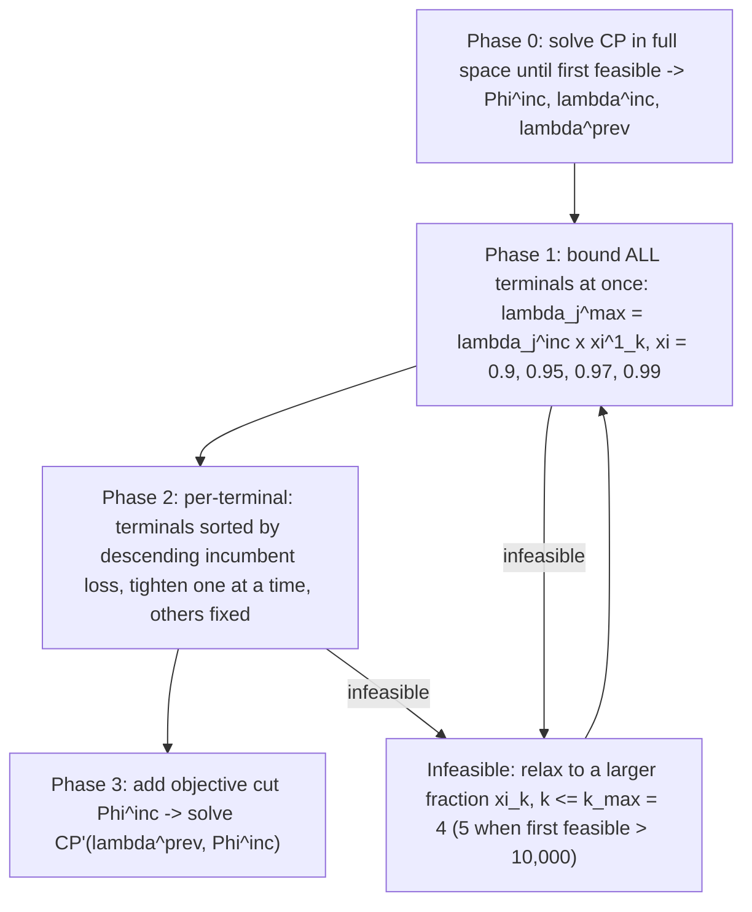

# Constraint Programming for LNG Ship Scheduling and Inventory Management (Goel, Slusky, van Hoeve, Furman & Shao, 2015)

> [!tldr] Goel et al. build two constraint-programming models of the same one-year LNG inventory-routing problem on a **disjunctive scheduling** representation (IBM ILOG CPOptimizer interval variables, `SequenceVar`, `NoOverlap`, cumul functions), then drive them with an iterative search that bounds losses through derived cumulative volume inequalities. On the largest instances the CP model with the ship-perspective encoding uses 15,375 variables vs 232,856 binary variables in the MIP; the approach is 4.55× faster than the specialized MIP heuristic on average, 10.5× with the iterative search, and finds better solutions on large instances.

## Problem & Contribution

- Same industrial problem as the MIP line (full-load/full-discharge LNG transport, production and regasification terminals, berth limits, annual demand, loss penalties): the paper's target is **speed on large instances** (up to 18 production terminals, 100 ships), where the arc-flow MIP model of Goel et al. (2012) needs 10+ hours.
- Contribution 1: two CP models. **CP1** encodes cargoes as interval variables at terminals; **CP2** enumerates maximal ship visits, so load/discharge alternation is built into the variable domains.
- Contribution 2: an iterative "cumulative volume lower bound based" search that turns the inventory equations into valid bounds on total losses, tightening the CP search space phase by phase.
- Contribution 3: computational evidence that CP scales with the number of tasks/resources rather than the number of time points, which is why discrete-time CP stays competitive when the MIP time grid blows up.

## Method / Architecture

CP1 primitives (paper §3, Laborie-style semantics): interval variable $c^J_{j,i}$ for cargo $i$ at terminal $j$ with domain $[t^{EC}_{j,i},\, t^{LC}_{j,i}+1)$; per-ship copies $c^{JV}_{j,i,v}$; `Alternative(c^J, {c^{JV}}_v)`; presence chain `presenceOf(c^J_i) ⇒ presenceOf(c^J_{i-1})`; `startOf(c^J_{i-1}) + τ_j ≤ startOf(c^J_i)`; berth `Σ_i pulse(c^J,1) ≤ b_j`; ship sequences `SequenceVar(A,θ_v)` with `First(seq_v, a_v)` (unavailability interval), `typeOfNext`, `NoOverlap(seq_v, M)` where $M(j,\varphi_1)=1$, $M(j,\varphi_2)=0$; inventory profiles as cumul functions $\tilde p_j=\sum_t \text{step}(t+1,p_{j,t})$, $\tilde d_j$, $\tilde z_j=\sum_{v,i}\text{stepAtEnd}(c^{JV},\gamma^V_v)$, $\tilde l_j=\sum_t\text{stepAtEnd}(slt,1,l_{j,t})$ with `alwaysIn` bounds; loss intervals `slt_{j,t}` with `alwaysEqual` complementarity constraints (paper Eqs. 21–24).

![[_papers/goel2015constraint/images/page_2_chart_15.jpg]]
![[_papers/goel2015constraint/images/page_2_chart_16.jpg]]
![[_papers/goel2015constraint/images/page_2_chart_19.jpg]]
*Fig. 1 (verbatim): Example of three elementary cumul functions. Here, $x$ is an interval variable, and $k$, $t$ are integers.* Subfigures (a) `pulse(x,k)`, (b) `stepAtEnd(x,k,kmin,kmax)`, (c) `step(t,k)`.

CP2 flips the perspective: variables are maximal ship visits $c^V_{v,i}$, each split by `Alternative` into cargo-side copies $c^{VJ}_{v,i,j}$, and parity sets $J^V_{v,i}$ force alternation — if ship $v$ starts at a production terminal then odd visits draw from the production set and even visits from the regas set, and vice versa. Full-load/full-discharge is therefore enforced **inside the variable domains**, so CP1's explicit alternation constraint is unnecessary; the cost is that CP2 cannot be extended to split deliveries.

The iterative search (paper §6, Algorithm 1):

The bound that makes this work (paper Eq. 45 for production terminals, 46–47 for regas terminals):

$$\tilde z_j \ \ge\ \text{step}\big(1,\ g^0_j-\gamma_j-\lambda_j\big)+\tilde p_j \quad \forall j\in L,\qquad \tilde z_j \ \ge\ \text{step}\big(1,\ -g^0_j-\lambda_j\big)+\tilde d_j \quad \forall j\in R$$

where $g^0_j$ is initial inventory, $\gamma_j$ the inventory bound, $\lambda_j$ the total allowed loss. Theorem 1: no feasible solution with $\lambda^s_j > \lambda^*_j$ can satisfy the bound set built for $\lambda^*$ — the search prunes loss levels, not schedules. The objective cut is $\Phi \le \Phi^{inc}$.

![[_papers/goel2015constraint/images/page_6_chart_2.jpg]]
*Fig. 2 (verbatim): A feasible and an infeasible loading schedule based on constraint (45) for illustrative example.* Example parameters: $p_{j,t}=60$, $g^0_j=0$, $\gamma_j=320$, $\lambda_j=0$; the two loading profiles load 900 units, the shaded region is infeasible.

Objective (paper Eq. 41, paraphrased):

$$\min\ \sum_{j\in R} w^D_j\max\Big(0,\ D_j-\sum_{v,i}\gamma^V_v\,\text{presenceOf}(c^{VJ}_{v,i,j})\Big)+\sum_{j\in J}\sum_{t\in T} w^T_{j,t}\,\text{heightAtEnd}(slt_j,\tilde l_j)$$ ^[inferred]

## Results

First feasible solution (paper Table 2, 5 h limit; TFF in seconds):

| Instance $(|L|,|R|,|V|)$ | MIP | MIP-Heur (Goel 2012) | CP1 | CP2 |
|---|---|---|---|---|
| P14 (1,10,69) | 494,236 @ 2,395 s | 70,474 @ 18 s | infeasible (1.9 GB) | **63,352 @ 4 s** |
| P18 (1,13,56) | 320,962 @ 821 s | 11,382 @ 22 s | infeasible (1.2 GB) | **10,266 @ 12 s** |
| P20 (1,18,100) | 525,058 @ 1,905 s | 19,596 @ 34 s | infeasible (3.0 GB) | **18,123 @ 22 s** |
| P13 (1,8,40) | 183,048 @ 101 s | 8,176 @ 11 s | 5,025 @ 1,138 s | **5,543 @ 7 s** |
| P1 (1,2,6) | 39,726 @ 3 s | — | — | **1,774 @ 1 s** |

Model sizes (paper Table 1):

| Instance | MIP (cont / 0-1 / constr) | CP1 (vars / constr / mem) | CP2 (vars / constr / mem) |
|---|---|---|---|
| P14 | 8,041 / 232,856 / 79,425 | 215,290 / 132,118 / 1.9 GB | 15,375 / 22,089 / 203 MB |
| P13 | 6,579 / 132,995 / 47,364 | 54,588 / 39,332 / 503 MB | 10,077 / 13,454 / 141 MB |
| P20 | 13,927 / 476,426 / 152,261 | 337,155 / 206,676 / 3.0 GB | 26,783 / 37,401 / 380 MB |

Best feasible solution reached (paper Table 3): CP2 beats MIP-Heur on P7 (1,510 vs 1,919 in 1 s), P11 (345 vs 375), P13 (1,438 vs 1,656), P16 (1,738 vs 1,762), P23 (3,232 vs 4,599), P24 (3,499 vs 5,600), P25 (3,341 vs 4,678), P18 (6,253 vs 7,441); MIP-Heur wins P14 (62,090 vs 62,962) and P20.

Speed-up on reaching the same solution quality (paper Table 4, geometric mean over instances):

| Configuration | Geometric mean speed-up vs MIP-Heur |
|---|---|
| CP2 (plain, 5 h) | 4.55 |
| CP-Heur-4x-1sol (CP-Heur-nxksol, n x sum_v |J^V_v|, k=1) | **10.5** (outliers P24 1,300, P7 916, P11 384.67) |
| CP-Heur-nx 32x | 7.86 |

Quality at matched time (paper Table 5, % gap vs best known, positive = CP better): CP2 is better on 13 of 18 instances, CP-Heur-4x-1sol on 17, CP-Heur-32x on 16; P13 +17.6/+45.6/+101.1, P11 +4.4/+39.1/+42.0, P16 −1.8/+66.2/+65.2, P2 −24.2/+4.1/−1.1, P4 (best known = 0, absolute gaps −350/+244/−393).

## Limitations

- CP1 runs out of memory on P14/P18/P20 (1.2–3.0 GB); CP2 is the only tractable encoding at that size.
- CP2's parity-set enumeration cannot represent split deliveries or split loads, so the model family is tied to the full-load/full-discharge assumption.
- Theorem 1 prunes **loss levels** with a valid inequality; it does not prove optimality, and the fraction schedule $\xi=[0.9,0.95,0.97,0.99]$ with $k_{max}=4$ (5 above objective 10,000) is a hand-set accuracy knob.
- CP2 is not uniformly best (P14, P20 lose to MIP-Heur), and the 4–10× speed-up is measured against a specialized heuristic, not against an exact MIP bound.
- Modeling assumptions carried over from the MIP line: one full day of loading/discharging occupies a berth, integer travel days, no seasonality, fixed discharge volume = load − nominal boil-off, fixed regas rates.

## Related

- [[concepts/disjunctive-scheduling-constraint-programming-model]]
- [[concepts/cumulative-volume-lower-bound-cp-search]]
- [[concepts/time-space-network-ship-flow-model]]
- [[concepts/mirp-modeling-continuous-vs-discrete-time]]
- [[concepts/maritime-inventory-routing-problem]]
- [[concepts/annual-lng-delivery-program]]
- [[concepts/periodic-scheduling-under-capacity-constraints]]
- [[concepts/cp-sat-hint-start]]
- [[concepts/adaptive-large-neighborhood-search-for-mip]]
- [[references/goel2012-large-neighborhood-search-lng-inventory-routing]]
- [[references/hendel2022-adaptive-lns-for-mip]]
- [[references/christiansen2008-maritime-inventory-routing-problems]]
- [[references/fagerholt2023-maritime-inventory-routing-survey]]

## Bibliographic Record

- Citation key: `goel2015constraint`
- DOI: `10.1016/j.ejor.2014.09.048`
- Canonical URL: <https://www.sciencedirect.com/science/article/pii/S0377221714007875>
- Publication: *European Journal of Operational Research* (2015-03-16)
- Authors: V. Goel; M. Slusky; W.-J. van Hoeve; K. C. Furman; Y. Shao
- Companion metadata note: [[_papers/goel2015constraint/goel2015constraint.md]]

## Sources

- [[_papers/goel2015constraint/goel2015constraint-extracted.md]]
- [[_papers/goel2015constraint/goel2015constraint.md]]
- [[_papers/goel2015constraint/images/page_2_chart_15.jpg]]
- [[_papers/goel2015constraint/images/page_2_chart_16.jpg]]
- [[_papers/goel2015constraint/images/page_2_chart_19.jpg]]
- [[_papers/goel2015constraint/images/page_6_chart_2.jpg]]
