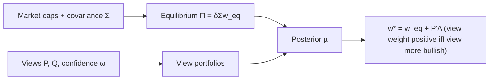

# The Intuition Behind Black-Litterman Model Portfolios

> [!tldr] He & Litterman show the unconstrained Black-Litterman optimal portfolio is the market equilibrium portfolio, scaled for equilibrium-return uncertainty, plus a weighted sum of view portfolios whose weights rise with bullishness and confidence.

## Problem & Contribution

- Mean-variance optimization requires a complete expected-return vector, and the resulting weights are "extreme and not particularly intuitive" (lines 24-26, 35).
- Black-Litterman, widely applied since its 1990 publication, combines market equilibrium with investor views on arbitrary portfolios, producing both expected returns and optimal weights (line 24).
- The manager expresses views about portfolios, not a full expected-return vector (line 75); the paper's key result is the decomposition: unconstrained BL weights = market equilibrium weights + weighted sum of view portfolios (lines 6, 113).

## Method

Reverse-optimized equilibrium returns with risk aversion δ = 2.5 (world average, line 65):

$$
\Pi = \delta\,\Sigma\,w_{eq}
$$

Posterior expected returns (Appendix B, line 219):

$$
\bar\mu = \left[(\tau\Sigma)^{-1}+P'\Omega^{-1}P\right]^{-1}\left[(\tau\Sigma)^{-1}\Pi+P'\Omega^{-1}Q\right]
$$

Optimal weights (Appendix B, line 221): $w^* = \Sigma^{-1}\bar\mu/\delta = w_{eq} + P'\Lambda$, where each view weight $\lambda_k$ increases with the view's bullishness $q_k$ and with confidence $1/\omega_k$ (Appendix B items 6-7, lines 221-225). Confidence is calibrated so the ratio ω/δ equals the view portfolio's variance, making only the ratio ω/τ enter the BL return formula — τ need not be specified separately (footnote 6, line 71).

Baseline illustrations: equal expected returns for all seven country markets produce extreme weights; starting from equilibrium returns makes optimal weights equal market weights, and the German view's translation causes puzzling adjustments in Australia, Canada, Japan and the US (lines 45-47, 67).

![[_papers/he2002intuition/images/page_3_chart_6.jpg]]
"Chart 1A. Optimal Weights, Traditional Mean-Variance Approach Starting from Equal Expected Returns"

![[_papers/he2002intuition/images/page_4_chart_6.jpg]]
"Chart 1B. Expected Returns, Traditional Mean-Variance Approach Starting from Equilibrium Expected Returns"

![[_papers/he2002intuition/images/page_5_chart_5.jpg]]
"Chart 1 C. Optimal Portfolio Weights, Traditional Mean-Variance Approach Starting from Equilibrium Expected Returns"

## Results

Single view: German equity outperforms European equities by 5% per year. Every chart page carries an "illustrative purposes only" disclaimer.

| Setting | Outcome (evidence) |
|---|---|
| Equal expected returns (all 7%) | Extreme weights: Germany −33.5%, Australia 71.4%, France −94.8% (lines 45-47, Chart 1A) |
| Equilibrium starting point | Optimal weights equal market weights (line 67, Charts 1B/1C) |
| One Germany/Europe view | Returns of France and UK also move via positive correlation (line 97, Chart 2A); weight deviations from equilibrium are exactly proportional to the long-Germany / short-market-cap-weighted-France+UK view portfolio (lines 105, 113, Charts 2B/2C) |
| Second view: Canada beats US by 3% p.a. | View portfolio weight increases as the view rises 3% → 4%; halving confidence halves the magnitude of the Germany/Europe weight adjustments (lines 131-139, Charts 3A/3B, Chart 4) |
| Sign rule | View weight is positive iff q > p'µ̄ (view more bullish than the model without it), zero iff q = p'µ̄ (line 143, line 221) |
| Risk-constrained variant | Scale unconstrained weights by 20%/volatility; extra exposure comes from the scaled market portfolio (line 155, Chart 5) |
| Risk + budget constraint | Linear combination of unconstrained optimum and global min-variance portfolio (line 163, Chart 6) |
| Risk + budget + beta constraint | Linear combination of unconstrained, min-variance, and market equilibrium portfolios (line 171, Chart 7) |

![[_papers/he2002intuition/images/page_7_chart_4.jpg]]
"Chart 2A. Expected Returns, Black-Litterman Model One View on Germany versus Rest of Europe"

![[_papers/he2002intuition/images/page_8_chart_3.jpg]]
"Chart 2B. Optimal Portfolio Weights, Black-Litterman Model One View on Germany versus the Rest of Europe"

![[_papers/he2002intuition/images/page_8_chart_7.jpg]]
"Chart 2C. Optimal Deviations from Equilibrium Weights Black-Litterman Model One View on Germany versus Rest of Europe"

![[_papers/he2002intuition/images/page_9_chart_4.jpg]]
"Chart 3A. Weights of Portfolios in the Views and Optimal Deviations Black-Litterman Model with Two Views"

![[_papers/he2002intuition/images/page_9_chart_7.jpg]]
"Chart 3B. Portfolio Weights, Black-Litterman Model with Two Views"

![[_papers/he2002intuition/images/page_10_chart_7.jpg]]
"Chart 4. Weights on Portfolios in the Views"

![[_papers/he2002intuition/images/page_11_chart_7.jpg]]
"Chart 5. Black-Litterman Model with Two Views, Risk Constrained"

![[_papers/he2002intuition/images/page_12_chart_5.jpg]]
"Chart 6. Black-Litterman Model with Two Views Risk and Budget Constrained"

![[_papers/he2002intuition/images/page_13_chart_3.jpg]]
"Chart 7. Black-Litterman Model with Two Views Risk, Budget, and Beta Constrained"

- The additive structure $w^* = w_{eq} + P'\Lambda$ is what lets constrained variants (risk, budget, beta) be written as linear combinations of the unconstrained optimum, the min-variance portfolio, and the equilibrium portfolio (Appendix C, lines 231-247). ^[inferred]
- Goldman Sachs practice: value and momentum factor portfolios serve as views, and one BL expected-return set is reused across many client portfolios and benchmarks (line 177).

## Limitations

- All charts are explicitly "for illustrative purposes only"; the paper presents no unified empirical testbed.
- Footnote calibration text is garbled in extraction (spacing artifacts around ω, δ, τ, and the confidence = 1−ω statement), so the exact calibration wording is uncertain (footnotes, lines 65, 71). ^[ambiguous]
- Appendix A tables (volatilities, weights, equilibrium returns, correlation matrix for the seven markets US, UK, Japan, Germany, France, Canada, Australia) extract with mirrored, garbled digits, so no table numbers are quoted here. ^[ambiguous]
- Publication year: the sidecar lists SSRN 2002 while the internal copyright line reads 1999 Goldman Sachs & Co. ^[ambiguous]

## Related

- [[references/black1992-global-portfolio-optimization]]
- [[concepts/black-litterman-view-blending]]
- [[references/idzorek20072-bl-confidence-levels]]

## Bibliographic Record

- Citation key: `he2002intuition`
- DOI: 10.2139/ssrn.334304
- URL: https://www.ssrn.com/abstract=334304
- Publication: preprint (SSRN), 2002; Goldman Sachs Quantitative Resources Group, internal copyright 1999
- Authors: Guangliang He, Robert Litterman
- Companion metadata: [[_papers/he2002intuition/he2002intuition.md|he2002intuition metadata]]
- Reference [2] of the paper is Black & Litterman (1992) "Global Portfolio Optimization", Financial Analysts Journal pp. 28-43 — the vault page [[references/black1992-global-portfolio-optimization]] (lines 249-257).

## Sources

- [[_papers/he2002intuition/he2002intuition-extracted.md]]
- [[_papers/he2002intuition/he2002intuition.md]]
- [[_papers/he2002intuition/images/page_3_chart_6.jpg]]
- [[_papers/he2002intuition/images/page_4_chart_6.jpg]]
- [[_papers/he2002intuition/images/page_5_chart_5.jpg]]
- [[_papers/he2002intuition/images/page_7_chart_4.jpg]]
- [[_papers/he2002intuition/images/page_8_chart_3.jpg]]
- [[_papers/he2002intuition/images/page_8_chart_7.jpg]]
- [[_papers/he2002intuition/images/page_9_chart_4.jpg]]
- [[_papers/he2002intuition/images/page_9_chart_7.jpg]]
- [[_papers/he2002intuition/images/page_10_chart_7.jpg]]
- [[_papers/he2002intuition/images/page_11_chart_7.jpg]]
- [[_papers/he2002intuition/images/page_12_chart_5.jpg]]
- [[_papers/he2002intuition/images/page_13_chart_3.jpg]]
