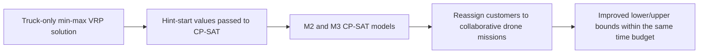

# Combining Heuristics and Constraint Programming for the Parallel Drone Scheduling Vehicle Routing Problem with Collective Drones

> [!tldr] The paper shows that seeding CP-SAT with a truck-only min-max VRP solution improves bounds and heuristic outcomes for PDSVRP-c, with collaborative drones yielding about 10% average time savings versus truck-only routing.

## Problem & Motivation

The paper studies last-mile delivery where multiple trucks and multiple drones cooperate in parallel. Some customers can be served by one truck tour, some by drone missions, and some by coordinated (collective) drone groups.

Without drones, the problem collapses to a min-max vehicle routing problem. The authors test whether this simpler truck-only solution can be used as a strong starting hint for harder CP models.

## Method / Architecture

Two CP-SAT models from prior work are reused:
- **M2**: giant-tour style truck variables plus drone assignment/synchronization variables.
- **M3**: truck-indexed routing variables and per-truck circuit constraints.

Hint-start strategy:
1. Solve a truck-only min-max VRP heuristic first.
2. Inject that solution as partial variable hints in CP-SAT.
3. Let CP-SAT reassign suitable customers to drones and refine schedules.

*Hint-start flow reconstructed from the text. ^[inferred]*

## Key Equations

Core objective (both models):

$$
\min \alpha
$$

where \(\alpha\) is the makespan and must dominate truck and drone completion times.

A useful reading of the objective is:

$$
\alpha \geq \max\{T_{\text{truck}}, T_{\text{drone}}\}
$$

(Conceptual restatement for interpretation. ^[inferred])

## Results

Implementation and setup reported in the paper:
- Python 3.11.2 + Google OR-Tools CP-SAT 9.6
- Intel i7-12700F, 32 GB RAM
- 1-hour limit per instance
- Benchmarks with 50–200 customers, 5–10 drones, and 2–5 trucks

Headline table slices (average row shown in the paper):

| Setting | Truck-only VRP UB | Best hint-start bound reported | Practical reading |
|---|---:|---|---|
| 2 trucks | 131.5 | [68.6, 117.2] | Better LB and better UB than truck-only baseline |
| 3 trucks | 99.7 | [51.1, 92.7] | Same pattern; hint-start improves final quality |

The paper concludes that hint-start is beneficial for both lower bounds and heuristic solutions, and that collaborative drones provide around 10% average time savings versus truck-only routing.

## Limitations

- The authors still report scalability pressure for large instances, especially tied to CP-SAT `Circuit` / `MultipleCircuit` behavior on larger VRP-like structures.
- Gains depend on how informative the initial truck-only hint is. ^[inferred]

## Related

- [[concepts/pdsvrp-c]]
- [[concepts/cp-sat-hint-start]]
- [[_papers/montemanni2024parallel/montemanni2024parallel-extracted]]
- [[_papers/nguyen2023parallel/nguyen2023parallel-extracted]]
- [[_papers/montemanni2023constraint/montemanni2023constraint-extracted]]

## Sources

- [[_papers/montemanni2024combining/montemanni2024combining-extracted.md]]
