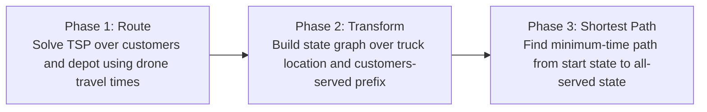

# Multi-visit Drone Routing Problem (Poikonen & Golden, 2020)

> [!tldr] The paper defines k-MVDRP (truck + k drones with multi-package sorties), proposes an RTS heuristic, and reports large route-time gains from faster drones and larger drone fleets.

## Problem & Motivation

The paper introduces the **k-Multi-visit Drone Routing Problem (k-MVDRP)**, where a truck acts as a moving depot and up to `k` drones repeatedly launch, deliver one or more packages, and rendezvous with the truck.

Compared with many earlier truck-drone models, this formulation explicitly allows:
- multiple heterogeneous packages per sortie,
- payload-dependent energy consumption,
- launch/landing locations decoupled from customer locations,
- repeated launch/recharge cycles over one route.

This removes several simplifications common in prior formulations and pushes the model closer to operational constraints.

## Method / Architecture

The paper models the problem with operation-level decisions and then introduces the **Route, Transform, Shortest Path (RTS)** heuristic because full operation enumeration is intractable at scale.

The diagram is a structural reconstruction of the three phases from the text, not a copied figure. ^[inferred]

Two important modeling restrictions are emphasized:
- during one operation, all launches happen at one truck location and all recoveries at one truck location;
- the truck does not make intermediate delivery stops while drones from that operation are airborne.

Within Phase 2, drone-customer assignment uses a block partitioning heuristic, which is exact in some edge cases (e.g., `k=1`, or each assigned customer count per operation not exceeding available drones).

## Key Equations

Operation-selection objective (paper formulation):

$$
\min \sum_{o \in O} t_o x_o
$$

with operation duration constrained by both truck and drone completion times:

$$
t_o \ge \text{truckTime}(o), \qquad
 t_o \ge \text{droneTime}_i(o)
$$

and coverage/flow/binary constraints over selected operations.

Energy feasibility for each sortie is enforced by payload-dependent travel energy plus hover wait energy:

$$
\sum \big(e(\cdot,\cdot,w)\, td(\cdot,\cdot)\big)
+ \text{HOV}\cdot\max\big(0,\,tt(v_i,v_j)-\text{droneTime}\big)
\le EMAX
$$

The two lower-bound families used in experiments are derived from (i) a close-enough TSP relaxation and (ii) a min-max mTSP relaxation.

## Results

Computations used Python 2.7; Gurobi 8.1 for Phase-1 TSP; 100 random instances (`|V|∈{25,50}`, `|C|∈{25,50}`), with 92 instances feasible across all tested parameter sets.

| Factor | Comparison | Reported effect on average objective |
|---|---|---|
| Drone speed | 10 m/s → 15 m/s | **26.0% lower** objective |
| Battery energy density | 540,000 → 900,000 J/kg | **8.0% lower** objective |
| Drone platform | quadrocopter → octocopter | **8.0% lower** objective |
| Fleet size | `k=1` → `k=8` | **58.1% lower** objective (with diminishing returns) |

Additional reported findings:
- RTS runtime was small (average **3.26 s**, about **7.32 s** on largest tested instances).
- Average objective-to-lower-bound gap was large (**56.0%**), suggesting substantial room for stronger bounds.
- The mTSP-derived lower bound exceeded the CETSP-derived bound in **85.8%** of instances.
- The 56% average objective-to-bound gap is the accuracy slot that learned construction policies such as [[concepts/transformer-seq2seq-routing-solver]] claim to fill at millisecond inference, and the payload-dependent EMAX sortie-feasibility constraint is the per-agent energy family that cooperative multi-agent fleets [[concepts/cooperative-multi-agent-uav-routing]] must respect. ^[inferred]

## Limitations

- RTS can be suboptimal because it commits to a TSP-derived visit order before transformation.
- Block assignment of customers to drones within an operation is heuristic and not globally optimal in general.
- Lower bounds omit different parts of synchronization/range structure, leaving a large average gap.
- The truck non-service-while-airborne restriction simplifies computation but may underuse truck capacity in practice.

These constraints indicate the approach prioritizes tractability over exactness on richer synchronization structures. ^[inferred]

## Related

- [[concepts/k-multi-visit-drone-routing-problem]]
- [[references/windrasmara2022-alns-multi-drop-fstsp]] — multi-drop FSTSP ALNS using a set-partitioning MIP in the Poikonen & Golden style.
- [[concepts/pdsvrp-c]]
- [[references/montemanni2024-pdsvrp-collective-drones]]
- [[concepts/cooperative-multi-agent-uav-routing]]
- [[concepts/transformer-seq2seq-routing-solver]]
- [[_papers/meng2023multivisit/meng2023multivisit-extracted]]
- [[_papers/cheng2020drone/cheng2020drone-extracted]]
- [[_papers/wang2019routing/wang2019routing-extracted]]

## Bibliographic Record

- Citation key: `poikonen2020multivisit`
- DOI: `10.1016/j.cor.2019.104802`
- Canonical URL: <https://www.sciencedirect.com/science/article/pii/S0305054819302448>
- Publication: *Computers & Operations Research* (2020)
- Authors: Stefan Poikonen; Bruce Golden
- Companion metadata note: [[_papers/poikonen2020multivisit/poikonen2020multivisit.md]]

## Sources

- [[_papers/poikonen2020multivisit/poikonen2020multivisit-extracted.md]]
- [[_papers/poikonen2020multivisit/poikonen2020multivisit.md]]
- [[_papers/poikonen2020multivisit/images/page_8_chart_2.jpg]]
- [[_papers/poikonen2020multivisit/images/page_21_chart_1.jpg]]
- [[_papers/poikonen2020multivisit/images/page_21_chart_3.jpg]]
- [[_papers/poikonen2020multivisit/images/page_26_chart_1.jpg]]
- [[_papers/poikonen2020multivisit/images/page_15_image_1.jpg]]
